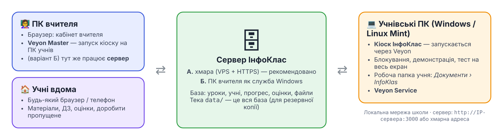
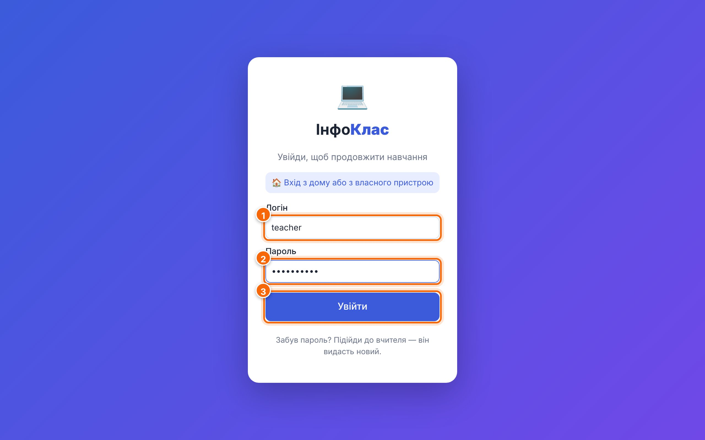
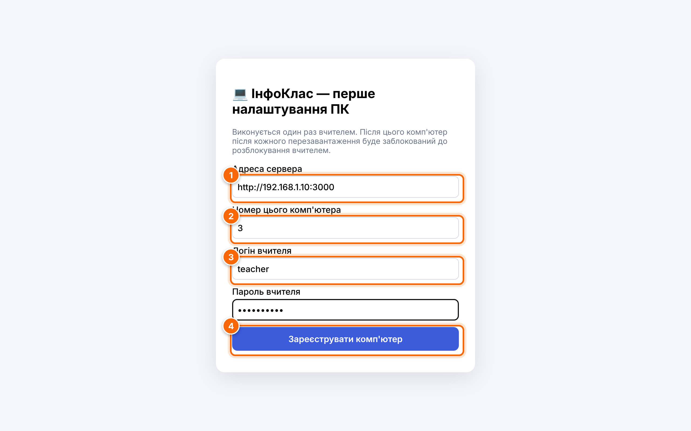
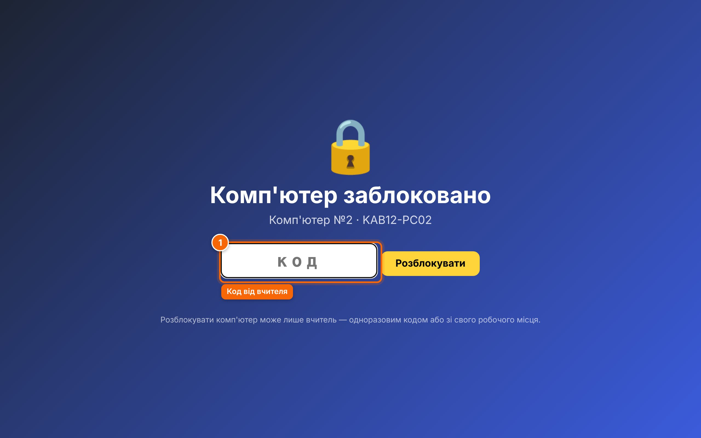
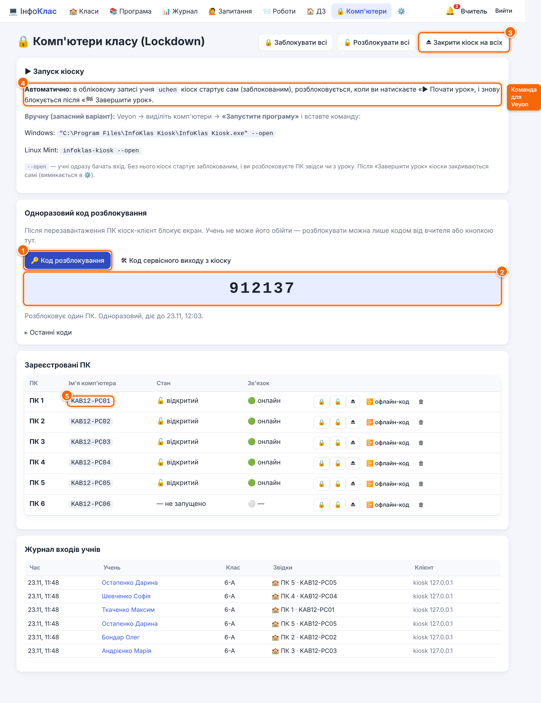
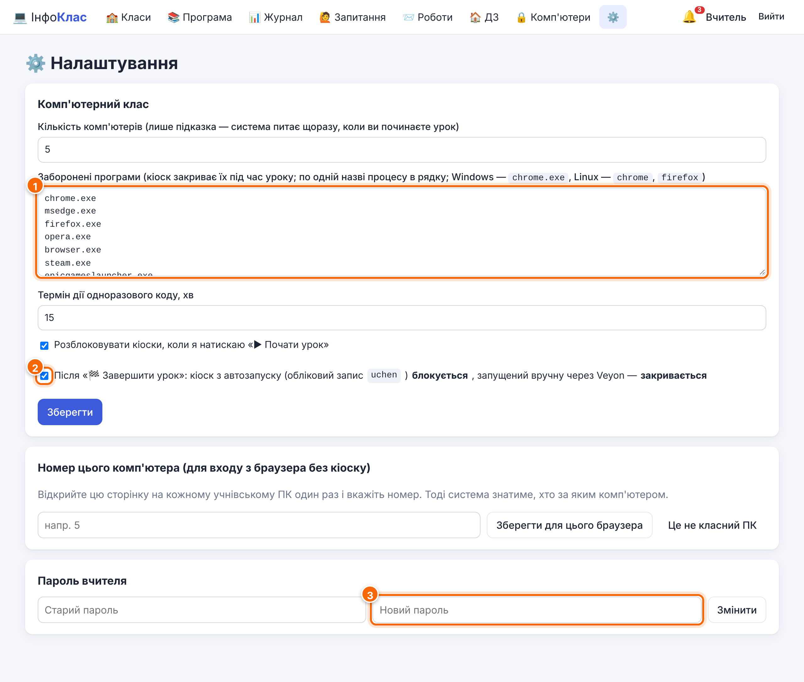

# ІнфоКлас — Інструкція адміністратора

*Встановлення сервера, підготовка учнівських комп'ютерів (Windows і Linux Mint), Veyon, перевірка та обслуговування.*

> **Для кого.** Для того, хто встановлює систему в школі: вчитель інформатики, лаборант або системний адміністратор.
> **Скільки часу.** Сервер — 15–30 хв. Один учнівський ПК — близько 10 хв.

---

## Зміст
1. [Як влаштована система](#1-як-влаштована-система)
2. [Вимоги](#2-вимоги)
3. [Встановлення сервера](#3-встановлення-сервера)
4. [Перший вхід і зміна пароля](#4-перший-вхід-і-зміна-пароля)
5. [Інсталятори кіоску](#5-інсталятори-кіоску)
6. [Учнівський ПК з Windows](#6-учнівський-пк-з-windows)
7. [Учнівський ПК з Linux Mint](#7-учнівський-пк-з-linux-mint)
8. [Veyon: запуск кіоску з ПК вчителя](#8-veyon-запуск-кіоску-з-пк-вчителя)
9. [Реєстрація кожного ПК (один раз)](#9-реєстрація-кожного-пк-один-раз)
10. [Налаштування: заборонені програми, коди розблокування](#10-налаштування-заборонені-програми-коди-розблокування)
11. [Перевірка перед першим уроком](#11-перевірка-перед-першим-уроком)
12. [Обслуговування: резервні копії, оновлення](#12-обслуговування-резервні-копії-оновлення)
13. [Якщо щось не працює](#13-якщо-щось-не-працює)

---

## 1. Як влаштована система



Система складається з двох програм:

| Частина | Де працює | Що робить |
|---|---|---|
| **Сервер ІнфоКлас** | у хмарі або на одному шкільному ПК | зберігає уроки, учнів, прогрес, оцінки, файли; відкривається в браузері |
| **Кіоск ІнфоКлас** | на кожному учнівському ПК | вікно, у якому працюють учні: блокування, демонстрація, тест на весь екран, робоча папка учня |

Кіоск **стартує сам у обліковому записі учня `uchen`** — заблокованим. Коли вчитель натискає «▶ Почати урок», кіоски розблоковуються, а після «🏁 Завершити урок» — знову блокуються. Облікових записів інших вчителів це не стосується: там кіоск не запускається. Запуск вручну через **Veyon** лишається запасним варіантом.

## 2. Вимоги

| | Мінімум | Рекомендовано |
|---|---|---|
| **Сервер у хмарі** | VPS 1 ядро, 1 ГБ RAM, 10 ГБ диска, Docker | 2 ГБ RAM, власний домен (для HTTPS) |
| **Сервер на шкільному ПК** | Windows 10/11, 4 ГБ RAM | ПК, який увімкнений під час уроків; постійна IP-адреса в мережі |
| **Учнівський ПК — Windows** | Windows 10/11 64-біт, 2 ГБ RAM | 4 ГБ RAM |
| **Учнівський ПК — Linux** | Linux Mint 21/22 (64-біт), 2 ГБ RAM, двоядерний процесор | Linux Mint **Xfce**, SSD |
| **Мережа** | усі ПК класу бачать сервер | дротова мережа в кабінеті |

> ⚠️ **Windows 7/8 не підтримуються кіоском.** Такі ПК краще перевести на Linux Mint Xfce (див. розділ 7) або використовувати без кіоску — у браузері.

## 3. Встановлення сервера

Оберіть **один** варіант.

| | **А. Хмарний сервер** (рекомендовано) | **Б. Шкільний ПК з Windows** |
|---|---|---|
| Учні працюють вдома | ✅ завжди | ⚠️ лише коли ПК увімкнений |
| Немає світла / тривога в школі | ✅ учні вдома працюють далі | ❌ сервер вимикається |
| Немає інтернету в школі | ❌ | ✅ клас працює в локальній мережі |
| Вартість | ~4–6 $/міс | безкоштовно |

### Варіант А. Хмарний сервер (Docker)

1. Орендуйте VPS з Ubuntu (Hetzner, DigitalOcean, Hostinger тощо) і встановіть Docker.
2. Завантажте проєкт і запустіть сервер:
   ```bash
   git clone https://github.com/svictorr-create/Infoklas.git && cd Infoklas
   docker build -t infoklas .
   docker run -d --name infoklas -p 3000:3000 -v infoklas-data:/data \
     -e TEACHER_PASSWORD='надійний-пароль' --restart unless-stopped infoklas
   ```
3. Налаштуйте **HTTPS** (обов'язково — без нього браузер не дозволить демонстрацію екрана та знімки). Найпростіше — Caddy:
   ```
   infoklas.vasha-shkola.ua {
     reverse_proxy localhost:3000
   }
   ```
4. Адреса для вчителя, учнів і кіосків: `https://infoklas.vasha-shkola.ua`.

### Варіант Б. Сервер на ПК вчителя (Windows)

1. Завантажте проєкт: на сторінці <https://github.com/svictorr-create/Infoklas> натисніть **Code → Download ZIP** і розпакуйте, наприклад, у `C:\Users\Вчитель\Downloads\Infoklas`.
2. Відкрийте **PowerShell від імені адміністратора**: Пуск → введіть `PowerShell` → правою кнопкою → *Запустити від імені адміністратора*.
3. Виконайте (підставте свій шлях і пароль):
   ```powershell
   cd C:\Users\Вчитель\Downloads\Infoklas
   Set-ExecutionPolicy -Scope Process Bypass -Force
   .\deploy\windows\install-server.ps1 -TeacherPassword "надійний-пароль"
   ```
   Скрипт сам встановить Node.js, зареєструє **службу Windows «InfoKlas»** (стартує при ввімкненні ПК) і відкриє порт 3000 у брандмауері для приватних адрес шкільної мережі (з інтернету він закритий).
4. Наприкінці скрипт покаже адреси, наприклад:
   ```
   Вчитель на цьому ПК:   http://localhost:3000
   Учні / кіоски в класі: http://192.168.1.10:3000
   ```
5. **Закріпіть IP-адресу** цього ПК у роутері (DHCP reservation), інакше після перезавантаження кіоски можуть не знайти сервер.

> 💡 На ПК-сервері вчитель відкриває систему саме як `http://localhost:3000` — тоді працюють демонстрація екрана та сповіщення.
> Доступ з дому (за бажанням): `winget install Cloudflare.cloudflared`, потім `cloudflared tunnel --url http://localhost:3000` — з'явиться адреса `https://…trycloudflare.com`.

## 4. Перший вхід і зміна пароля

Відкрийте адресу сервера в браузері та увійдіть як вчитель (логін `teacher`, пароль — той, що ви вказали; якщо не вказували — `teacher123`).



Одразу змініть пароль: **⚙️ Налаштування → Пароль вчителя** (позначка ③ на знімку в розділі 10).

> Під час першого запуску створюються демо-курс «Інформатика. 6 клас» і клас «6-А» з кількома учнями — щоб було на чому потренуватися. Їх можна видалити або змінити.

## 5. Інсталятори кіоску

Готові інсталятори збираються автоматично на GitHub:

1. Відкрийте <https://github.com/svictorr-create/Infoklas/actions>.
2. Ліворуч оберіть **«Збірка кіоску»** → **Run workflow** → **Run workflow**.
3. Через 5–10 хв відкрийте запуск і внизу, в розділі **Artifacts**, завантажте:
   - `infoklas-kiosk-windows` → усередині `InfoKlas Kiosk Setup 1.2.0.exe`
   - `infoklas-kiosk-linux` → усередині `infoklas-kiosk_1.2.0_amd64.deb`

Файли зберігаються 90 днів, потім збірку можна запустити знову.

## 6. Учнівський ПК з Windows

### ⚡ Автоматично для багатьох ПК (рекомендовано)

Сервер сам роздає інсталятор і скрипт, а ПК реєструється без вікна налаштування. Для 18 ПК — по 2–3 хвилини на кожен.

**Один раз на сторінці 🔒 Комп'ютери → «⚡ Автоматичне встановлення кіоску»:**
1. **Завантажте на сервер** `InfoKlas Kiosk Setup 1.2.0.exe` (з GitHub → Actions → «Збірка кіоску» → Artifacts).
2. Перевірте **адресу сервера для учнівських ПК** (наприклад `http://192.168.1.10:3000`; якщо ви на самому сервері — мережеву адресу підставлено автоматично).
3. Введіть **пароль облікового запису `uchen`** (однаковий для всіх ПК) і за бажанням — автовхід.
4. **🔑 Створити файл встановлення** — завантажиться `install-kiosk.bat` (ключ діє 8 годин). Скопіюйте його на флешку.

**На кожному учнівському ПК** (під обліковим записом адміністратора):
1. Правою кнопкою по `install-kiosk.bat` → **«Запуск від імені адміністратора»**.
2. Підтвердіть **номер ПК** — Enter бере номер з імені комп'ютера (`KAB12-PC05` → 5).
3. Дочекайтеся «ГОТОВО» → **перезавантажте** ПК. Він одразу з'явиться в таблиці «Зареєстровані ПК».

Повторний запуск на тому самому ПК перевстановлює кіоск і реєструє ПК заново (старий запис з тим самим номером замінюється). Якщо кіоск зараз працює в `uchen`, спершу закрийте його (⏏ на сторінці «Комп'ютери») або перезавантажте ПК і запускайте під адміністратором.

> ⚠️ Якщо ви вказали пароль `uchen`, він записаний у `install-kiosk.bat` — після встановлення видаліть файл з флешки. Ключ встановлення сам перестає діяти через 8 годин.

### Вручну (один ПК)

Скопіюйте на ПК (наприклад, з флешки) в одну теку:
- `InfoKlas Kiosk Setup 1.2.0.exe`
- `setup-student.ps1` (з теки `kiosk/windows/` проєкту)

Відкрийте **PowerShell від імені адміністратора** у цій теці та виконайте:

```powershell
Set-ExecutionPolicy -Scope Process Bypass -Force
.\setup-student.ps1 -Installer ".\InfoKlas Kiosk Setup 1.2.0.exe"
```

Скрипт попросить пароль для облікового запису учня **`uchen`** — придумайте один для всіх ПК (знатимете лише ви).

**Що зробить скрипт:**

| Дія | Навіщо |
|---|---|
| Встановить кіоск у `C:\Program Files\InfoKlas Kiosk\` | — |
| Створить обліковий запис **uchen** без прав адміністратора | учні не зможуть нічого встановити чи зламати |
| Для `uchen` вимкне Диспетчер задач, командний рядок, regedit, Панель керування, Win+R | щоб не можна було закрити кіоск |
| Сховає «Змінити користувача» та екран блокування Windows | — |
| Додасть кіоск в **автозапуск облікового запису `uchen`** | учень входить у Windows — кіоск уже заблокував екран |

Додаткові параметри (за бажанням):
- `-AutoLogin` — Windows після ввімкнення одразу входить в `uchen` (тоді ПК після ввімкнення одразу показує екран блокування кіоску);
- `-NoAutoStart` — не запускати кіоск автоматично (лише вручну через Veyon).

> **SmartScreen** може показати «Windows захистила ваш ПК» — інсталятор не має платного цифрового підпису. Натисніть **Докладніше → Усе одно запустити**.

## 7. Учнівський ПК з Linux Mint

Підходить і для старих двоядерних ПК (беріть **Linux Mint Xfce Edition**).

Скопіюйте на ПК `infoklas-kiosk_1.2.0_amd64.deb` і `setup-mint.sh` (з теки `kiosk/linux/`), відкрийте термінал у цій теці:

```bash
sudo bash setup-mint.sh infoklas-kiosk_1.2.0_amd64.deb
```

Скрипт встановить кіоск (команда `infoklas-kiosk`), створить обліковий запис **`uchen`** без прав адміністратора, заборонить перемикання в консоль (Ctrl+Alt+F1…F6) і Ctrl+Alt+Backspace, вимкне гостьовий сеанс.

Під час блокування й демонстрації кіоск сам вимикає Alt+Tab, клавішу Super (меню), Ctrl+Alt+T (термінал), Alt+F4 — і повертає їх після уроку (навіть якщо ПК вимкнули аварійно).

Кіоск запускатиметься **автоматично під час входу в `uchen`** (заблокованим).

Додатково: `--autologin` — автовхід в `uchen`; `--no-autostart` — без автозапуску (лише вручну через Veyon).

## 8. Як кіоск працює під час уроку

| Подія | Що відбувається на учнівських ПК (обліковий запис `uchen`) |
|---|---|
| Учень входить у Windows / Linux | кіоск стартує сам і показує **«Комп'ютер заблоковано»** |
| Вчитель натискає **▶ Почати урок** | кіоски **розблоковуються** — учні бачать вхід |
| Режими «Презентація», «Мій екран», «Увага!» | кіоск на весь екран, вийти не можна |
| Вчитель натискає **🏁 Завершити урок** | кіоски **знову блокуються** (не закриваються) |
| ⏏ Закрити кіоск на всіх / код сервісного виходу | кіоск закривається (обслуговування ПК) |

Обидві автоматичні дії можна вимкнути в **⚙️ Налаштування**.

### Запуск вручну через Veyon (запасний варіант)

Потрібен, якщо автозапуск вимкнено (`-NoAutoStart` / `--no-autostart`) або учні працюють під іншим обліковим записом.

Якщо у вас ще немає Veyon — встановіть з <https://veyon.io>: **Veyon Service** на кожен учнівський ПК, **Veyon Master** — на ПК вчителя (інструкція на сайті Veyon).

На початку уроку у **Veyon Master**: виділіть учнівські комп'ютери → **«Запустити програму»** (*Run program*) → вставте команду:

| ОС учнівського ПК | Команда |
|---|---|
| Windows | `"C:\Program Files\InfoKlas Kiosk\InfoKlas Kiosk.exe" --open` |
| Linux Mint | `infoklas-kiosk --open` |

Збережіть команду у Veyon, щоб наступного разу обирати її зі списку.

- `--open` — учні одразу бачать вхід. Без нього кіоск стартує **заблокованим**, і вчитель розблоковує ПК кнопкою або кодом.
- Повторна команда не відкриє другу копію — лише покаже вже відкрите вікно.
- Кіоск, запущений вручну, після «🏁 Завершити урок» закривається сам.

## 9. Реєстрація кожного ПК (один раз)

Під час **першого** запуску кіоску на ПК (перший вхід у `uchen` після встановлення) з'явиться вікно налаштування:



1. **Адреса сервера** — з розділу 3 (`http://192.168.1.10:3000` або хмарна адреса).
2. **Номер цього комп'ютера** — як наклейка на ПК (1, 2, 3…). За цим номером працює розсадка.
3. **Логін** і пароль вчителя.
4. **Зареєструвати комп'ютер.**

Після реєстрації ПК з'явиться на сторінці **🔒 Комп'ютери** разом з іменем комп'ютера в Windows/Linux (так легко зіставити з Veyon).

Після входу в `uchen` (і після кожного уроку) учні бачать екран блокування:



Розблокувати можна:
- **автоматично**, коли вчитель натискає «▶ Почати урок»;
- кнопкою **🔓 Розблокувати ПК** на сторінці уроку чи **Розблокувати всі** на сторінці «Комп'ютери»;
- **одноразовим кодом** (діє 15 хв і лише один раз);
- **офлайн-кодом** — працює навіть без зв'язку з сервером.

## 10. Налаштування: заборонені програми, коди розблокування

### Сторінка «🔒 Комп'ютери»



1. **Код розблокування** — одноразовий код для одного ПК.
2. Код, який диктуєте учневі (або вводите самі).
3. **Закрити кіоск на всіх** — якщо урок не завершували кнопкою.
4. Готова **команда для Veyon** (Windows і Linux).
5. **Ім'я комп'ютера** в Windows/Linux — як у Veyon.

У таблиці також: 🔒/🔓/⏏ для кожного ПК, **📴 офлайн-код**, видалення ПК. Нижче — **журнал входів учнів** (хто, коли, з якого ПК).

### ⚙️ Налаштування



1. **Заборонені програми** — назви процесів, які кіоск закриває під час уроку. Windows: `chrome.exe`, Linux: `chrome`, `firefox`. Список уже заповнено типовими браузерами й іграми.
2. **Закривати кіоск після «Завершити урок»** — увімкнено за замовчуванням.
3. **Пароль вчителя.**

Також тут: кількість комп'ютерів (лише підказка — система питає щоразу на початку уроку), термін дії коду, номер ПК для роботи без кіоску (у браузері).

## 11. Перевірка перед першим уроком

На одному учнівському ПК (10 хвилин):

- [ ] Увійдіть в `uchen` → кіоск стартував сам і показує «Комп'ютер заблоковано» з правильним номером ПК.
- [ ] Вчитель натиснув **▶ Почати урок** → на ПК з'явилося вікно входу.
- [ ] На сторінці уроку біля цього ПК — 🖥 (кіоск запущено).
- [ ] Одноразовий код спрацьовує один раз, вдруге — ні.
- [ ] Ctrl+Shift+Esc, Ctrl+Alt+Del → «Диспетчер задач» **не** відкривається (Windows).
- [ ] Ctrl+Alt+F2 **не** перемикає в консоль; Alt+Tab під час «👀 Увага!» не працює (Linux).
- [ ] Режим **👀 Увага!** — екран учня заблокований.
- [ ] Запустіть Chrome/Firefox під час уроку — кіоск закриє його за кілька секунд, вчитель отримає сповіщення.
- [ ] **🔗 Відкрити посилання** в режимі тесту — вікно на весь екран, учень не може закрити.
- [ ] **📤 Файли учням** — файл з'являється в `Документи › InfoKlas › <Учень> › <Урок>`.
- [ ] Учень тисне **«Я закінчив»** — вчитель бачить знімок екрана і файли.
- [ ] **🏁 Завершити урок** — кіоск знову показує «Комп'ютер заблоковано».
- [ ] Увійдіть під обліковим записом іншого вчителя — кіоск **не** запускається.

## 12. Обслуговування: резервні копії, оновлення

**Резервна копія.** Уся база — одна тека:
- Windows-сервер: `C:\InfoKlas\data`
- Docker: том `infoklas-data` (`docker cp infoklas:/data ./backup`)

Копіюйте її раз на тиждень (флешка, Google Диск). Відновлення — просто повернути теку на місце й перезапустити сервер.

**Оновлення сервера:**
- Windows: завантажте нову версію проєкту й повторно запустіть `install-server.ps1` — дані в `C:\InfoKlas\data` збережуться.
- Docker: `git pull`, `docker build -t infoklas .`, перезапустіть контейнер з тим самим томом.

**Оновлення кіоску:** зберіть нові інсталятори (розділ 5) і встановіть поверх старих (Windows — запуском `.exe`, Linux — `sudo apt install ./infoklas-kiosk_*.deb`). Реєстрацію ПК повторювати не треба.

**Журнал сервера:** Windows — `C:\InfoKlas\logs\server.log`; Docker — `docker logs infoklas`.

## 13. Якщо щось не працює

| Проблема | Що зробити |
|---|---|
| Пінг на сервер є, а браузер пише «Немає зв'язку з сайтом» | 1) На сервері відкрийте `http://localhost:3000` — якщо не відкривається, служба не запущена: `nssm start InfoKlas`, журнал `C:\InfoKlas\logs\server.log`. 2) Брандмауер: мережа типу «Загальнодоступна» — повторно запустіть `install-server.ps1` (нова версія відкриває порт для будь-якого типу мережі) або створіть правило вручну (див. нижче). 3) Вводьте адресу повністю: `http://IP:3000`. 4) Антивірус з власним брандмауером — дозвольте порт 3000. |
| Кіоск: «Немає зв'язку з сервером» | Перевірте, що ПК бачить сервер: відкрийте його адресу в браузері. Перевірте IP-адресу сервера та брандмауер. |
| ПК не з'являється в «Комп'ютери» | Кіоск ще не реєструвався — запустіть його й заповніть вікно налаштування (розділ 9). |
| Учень бачить «Комп'ютер заблоковано», а урок уже йде | Натисніть 🔓 Розблокувати ПК на сторінці уроку (кіоск міг стартувати вже після «Почати урок»). |
| Кіоск не стартує після входу в `uchen` | Перевірте автозапуск: повторно запустіть скрипт підготовки ПК без `-NoAutoStart`. Або запустіть вручну через Veyon. |
| Немає інтернету, кіоск заблокований | 🔒 Комп'ютери → **📴 офлайн-код** для цього ПК — працює без зв'язку. |
| Демонстрація екрана / знімок не працюють у браузері | Потрібен HTTPS або `http://localhost` на ПК-сервері. У кіоску працюють завжди. |
| Учень перезавантажив ПК посеред уроку | Вчитель отримає сповіщення «⚠️ ПК N: кіоск зник під час уроку». Після входу в `uchen` кіоск стартує сам — натисніть 🔓 Розблокувати ПК. |
| Windows: «Windows захистила ваш ПК» | Докладніше → Усе одно запустити (інсталятор без платного підпису). |
| Linux: Alt+Tab не працює після уроку | Вийдіть і знову увійдіть в обліковий запис — клавіші відновляться автоматично. |
| Учень забув пароль | Вчитель: Учні → **🔑 Новий пароль**. |

> **Що Windows не дозволяє заблокувати повністю:** меню Ctrl+Alt+Del завжди з'являється (з кнопками «Вийти»/«Завершити роботу»), але Диспетчер задач у ньому вимкнений. Якщо учень вийде з облікового запису, Windows попросить пароль `uchen`, який знаєте лише ви.

**Ручне правило брандмауера на сервері** (PowerShell від імені адміністратора):
```powershell
New-NetFirewallRule -DisplayName "InfoKlas" -Direction Inbound -Protocol TCP -LocalPort 3000 -Action Allow -Profile Any -RemoteAddress 10.0.0.0/8,172.16.0.0/12,192.168.0.0/16
```
Перевірка з учнівського ПК: `Test-NetConnection <IP-сервера> -Port 3000` (Windows) або `curl -I http://<IP-сервера>:3000` (Linux) — має бути `TcpTestSucceeded : True` / відповідь `HTTP/1.1`.

