# ІнфоКлас — Інструкція мобільного додатка

*Додаток вчителя для Android: встановлення, керування уроком з телефона, сповіщення, журнал і перевірка робіт.*

> **Для кого.** Для вчителя, який хоче вести урок не прив'язуючись до свого комп'ютера: ходити класом, відповідати на запитання учнів, гортати презентацію й ставити оцінки з телефона.
> **Що потрібно.** Телефон з Android 8 або новішим (перевірено для Android 16), файл `InfoKlas-Vchytel-1.0.x.apk` і адреса сервера школи.

---

## Зміст
1. [Що вміє додаток](#1-що-вміє-додаток)
2. [Встановлення](#2-встановлення)
3. [Перший запуск](#3-перший-запуск)
4. [Головний екран і навігація](#4-головний-екран-і-навігація)
5. [Почати урок](#5-почати-урок)
6. [Урок наживо](#6-урок-наживо)
7. [Учень: пересадити, роль, вміння, папка](#7-учень-пересадити-роль-вміння-папка)
8. [Запитання учнів і сповіщення](#8-запитання-учнів-і-сповіщення)
9. [Телефон як пульт презентації](#9-телефон-як-пульт-презентації)
10. [Посилання, тест і файли учням](#10-посилання-тест-і-файли-учням)
11. [Журнал і оцінки](#11-журнал-і-оцінки)
12. [Папка учня: перевірити роботу](#12-папка-учня-перевірити-роботу)
13. [Налаштування додатку](#13-налаштування-додатку)
14. [Поради та обмеження](#14-поради-та-обмеження)
15. [Якщо щось не працює](#15-якщо-щось-не-працює)

---

## 1. Що вміє додаток

Додаток відкриває **той самий кабінет вчителя**, що й у браузері на комп'ютері — тому всі функції однакові, а нові можливості системи з'являються в додатку автоматично, без оновлення.

| Можливість | У додатку |
|---|---|
| Почати й завершити урок, тривога | ✅ |
| Режими: Практична, Презентація, Увага! | ✅ (телефон — пульт для презентації) |
| Режим «📺 Мій екран» | ❌ лише з комп'ютера |
| Присутність, розсадка, ролі | ✅ (пересадка — вибором номера ПК) |
| Відповіді на запитання учнів | ✅ + **вібрація та сповіщення Android** |
| Відкрити посилання / тест на ПК учнів | ✅ |
| Надіслати файли учням | ✅ (з пам'яті телефона) |
| Журнал, оцінки, вміння, CSV | ✅ (файли — у *Завантаження/InfoKlas*) |
| Папка учня, перегляд документів | ✅ |
| Редагування уроків, учні, паролі | ✅ (зручніше з комп'ютера) |

## 2. Встановлення

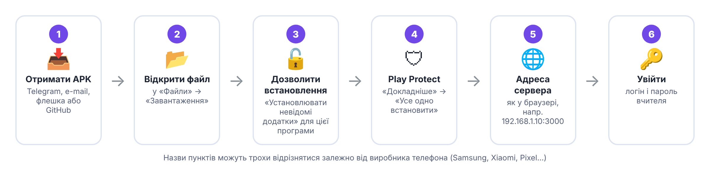

1. **Отримайте файл** `InfoKlas-Vchytel-1.0.x.apk` — адміністратор може надіслати його в Telegram, e-mail або скопіювати з комп'ютера. (Адміністратор збирає його на GitHub: Actions → «Додаток вчителя (APK)».)
2. **Відкрийте файл** на телефоні: програма «Файли» → «Завантаження» → торкніться APK.
3. Android попросить **дозволити встановлення невідомих додатків** для програми, з якої ви відкрили файл (Файли, Telegram, Chrome…). Увімкніть перемикач «Дозволити з цього джерела» і поверніться назад.
4. Якщо з'явиться **Google Play Protect** («Невідомий розробник» / «Заблоковано Play Protect») — натисніть **«Докладніше» → «Усе одно встановити»**. Це звичайне попередження для будь-якого додатку не з Google Play.
5. Натисніть **«Встановити»**, потім **«Відкрити»**. Значок **ІнфоКлас** з'явиться серед додатків.

**Оновлення.** Нову версію встановлюйте так само — поверх старої, налаштування й вхід збережуться. Якщо Android пише «Додаток не встановлено, оскільки пакет конфліктує з наявним» — нову версію підписано іншим ключем: видаліть старий додаток і встановіть новий (попросіть адміністратора збирати APK тим самим ключем).

**Видалення.** Утримуйте значок → «Видалити». Дані в системі (уроки, журнал) не зачіпаються — вони на сервері.

## 3. Перший запуск

### Адреса сервера

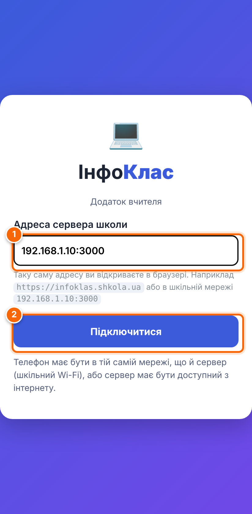

1. Введіть **адресу сервера школи** — ту саму, що відкриваєте в браузері на комп'ютері:
   - сервер у хмарі: `https://infoklas.vasha-shkola.ua`;
   - сервер у шкільній мережі: `192.168.1.10:3000` (телефон має бути підключений до **шкільного Wi-Fi**).
2. **Підключитися.**

Android запитає дозвіл на **сповіщення** — натисніть **«Дозволити»**, інакше ви не дізнаєтесь про запитання учнів, коли телефон у кишені.

### Вхід

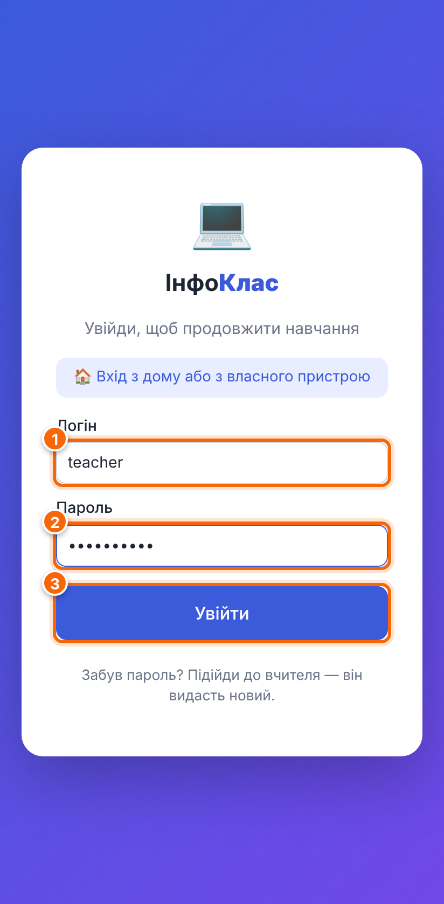

1. Логін вчителя. 2. Пароль. 3. **Увійти.**

Додаток запам'ятовує вхід — наступного разу відкриється одразу ваш кабінет.

## 4. Головний екран і навігація

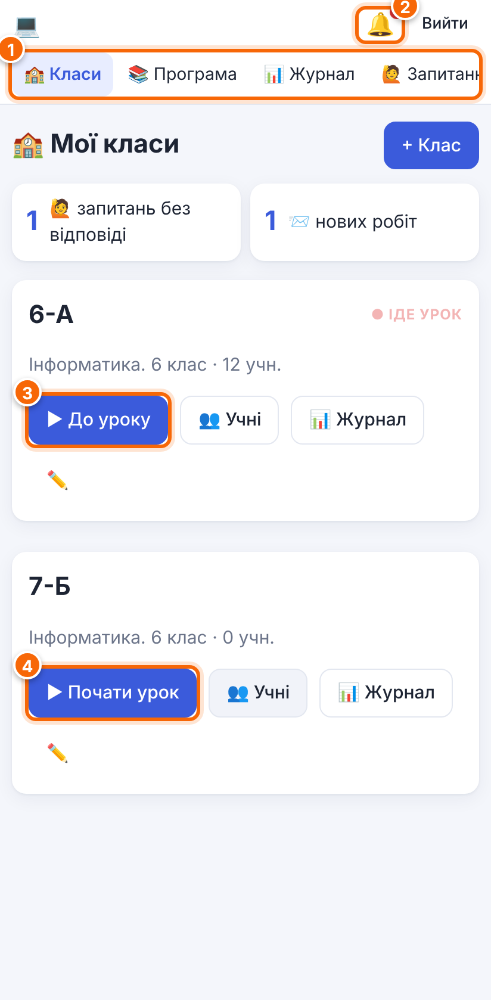

1. **Меню розділів** — прокручується вбік пальцем: Класи, Програма, Журнал, Запитання, Роботи, ДЗ, Комп'ютери, ⚙️.
2. **🔔 Сповіщення** — червоне число показує нові події.
3. **▶ До уроку** — якщо урок уже йде.
4. **▶ Почати урок** для класу.

**Кнопка «Назад» телефона** спершу закриває відкрите вікно (наприклад, відповідь учню), потім повертає на попередню сторінку, а на першій сторінці — згортає додаток.

## 5. Почати урок

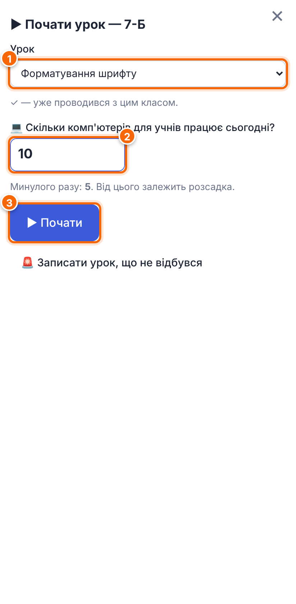

1. Оберіть **урок**.
2. Вкажіть, **скільки комп'ютерів** працює сьогодні.
3. **▶ Почати** — кіоски на учнівських ПК розблокуються самі.

## 6. Урок наживо

Верхня частина — керування уроком:

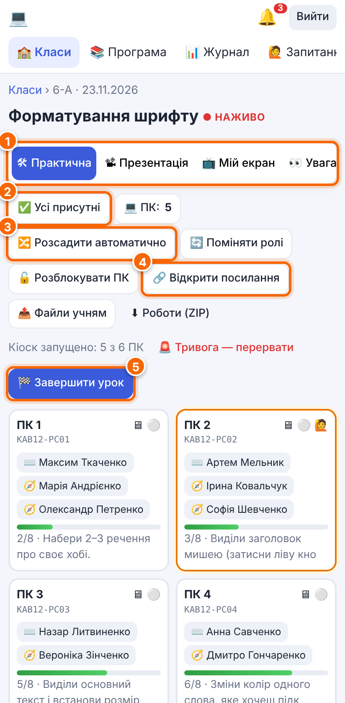

1. **Режими:** 🛠 Практична · 📽 Презентація · 📺 Мій екран (лише з комп'ютера) · 👀 Увага! (прокрутіть вбік).
2. **✅ Усі присутні.**
3. **🔀 Розсадити автоматично.**
4. **🔗 Відкрити посилання** (тест) на ПК учнів.
5. **🏁 Завершити урок.**

Нижче — **комп'ютери класу** (по два в ряд):

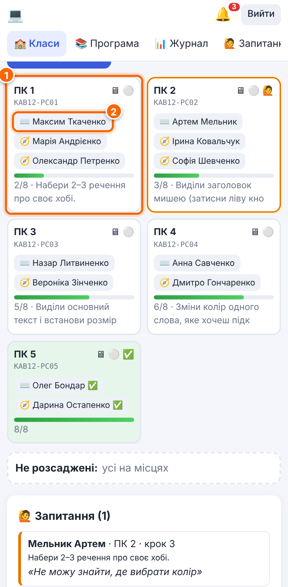

1. Картка ПК: ім'я комп'ютера, хто сидить, прогрес кроків, поточний крок. Значки: 🖥 кіоск працює, 🟢 учень у системі, 🙋 запитання, ✅ завершив, ⚠️ вийшов з вікна демонстрації.
2. **Торкніться імені учня** — відкриється вікно учня (розділ 7).

Ще нижче — **запитання**, **відкриті посилання**, **хто завершив** і **присутність**:

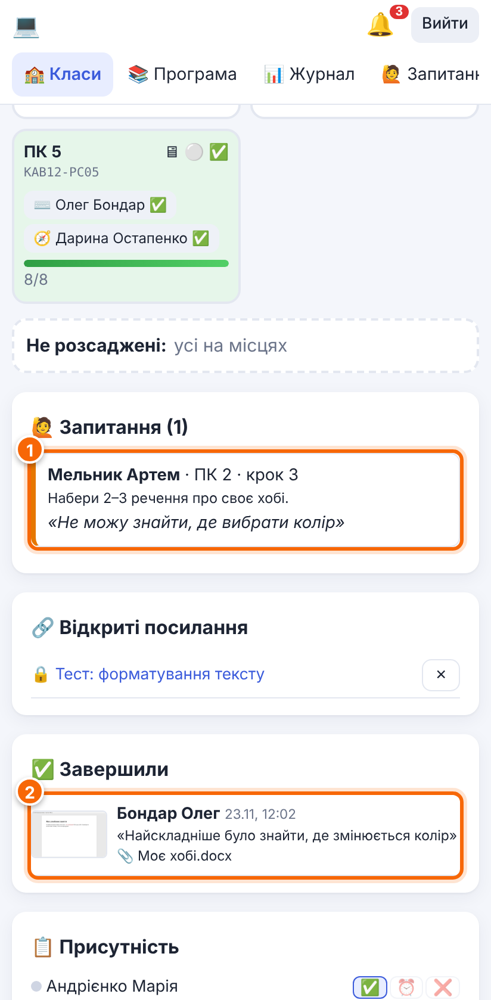

1. Запитання учня — торкніться, щоб відповісти.
2. Завершена робота — знімок екрана, файли, рефлексія.

## 7. Учень: пересадити, роль, вміння, папка

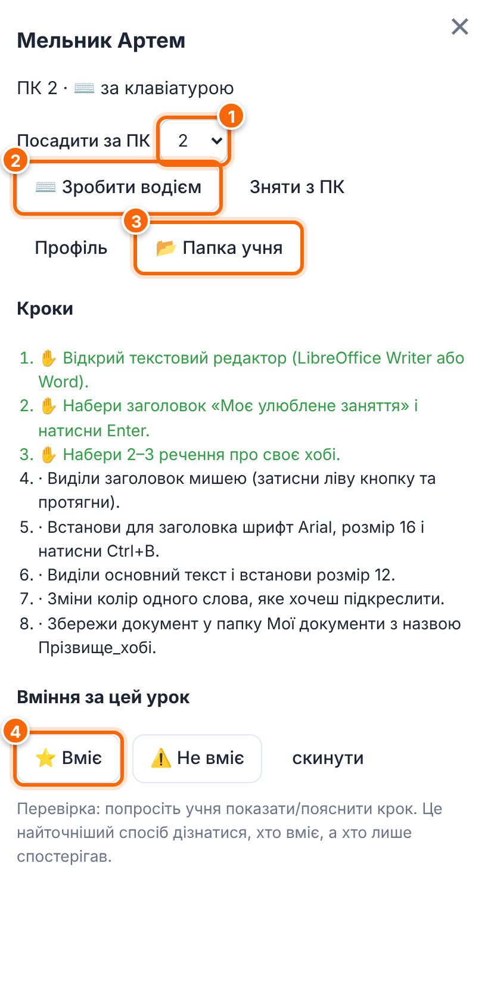

1. **Посадити за ПК** — оберіть номер (на телефоні замість перетягування).
2. **⌨️ Зробити водієм** — учень сідає за клавіатуру.
3. **📂 Папка учня** — його документи з комп'ютера (розділ 12).
4. **⭐ Вміє / ⚠️ Не вміє** — підтвердження після короткої перевірки «покажи, як ти це зробив».

## 8. Запитання учнів і сповіщення

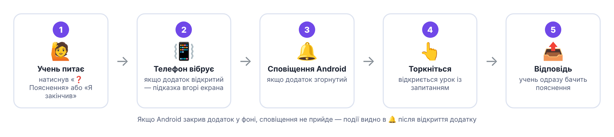

Коли учень натискає **❓ Пояснення** або **«Я закінчив»**:
- якщо додаток відкритий — телефон **вібрує**, угорі з'являється підказка;
- якщо додаток згорнутий — приходить **сповіщення Android**; торкніться його — відкриється урок.

Відповідь на запитання:

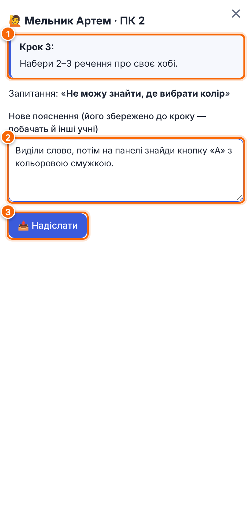

1. Крок і запитання учня.
2. Напишіть пояснення (або надішліть уже наявне одним дотиком).
3. **📤 Надіслати** — учень одразу бачить пояснення на своєму ПК.

## 9. Телефон як пульт презентації

Увімкніть **📽 Презентація** — на всіх ПК учнів з'явиться PDF-презентація уроку, а на телефоні — пульт:

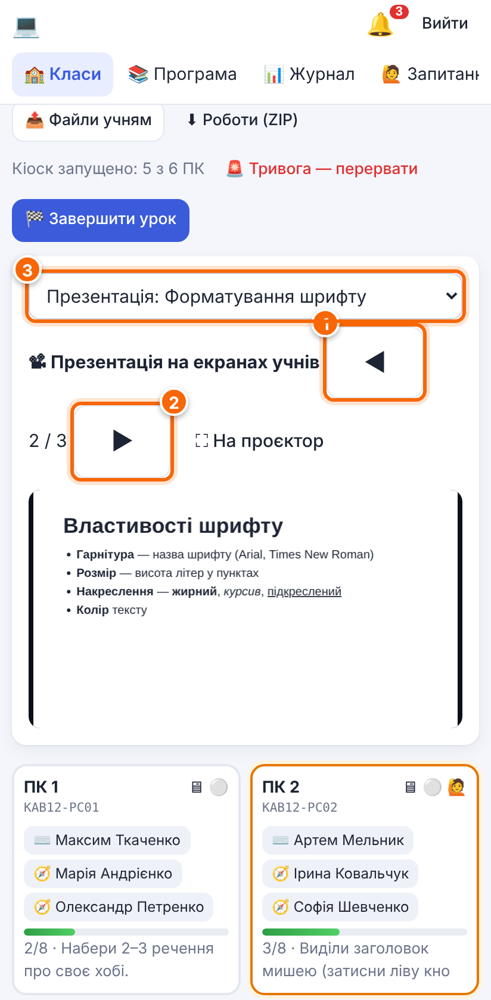

1. ◀ — попередній слайд.
2. ▶ — наступний слайд.
3. Вибір файлу презентації.

**👀 Увага!** блокує екрани учнів одним дотиком. Повернутися до роботи — **🛠 Практична**.

> «📺 Мій екран» (трансляція екрана) з телефона недоступний — Android не дозволяє це з вбудованого браузера. Використовуйте «Презентацію» або вмикайте трансляцію з комп'ютера.

## 10. Посилання, тест і файли учням

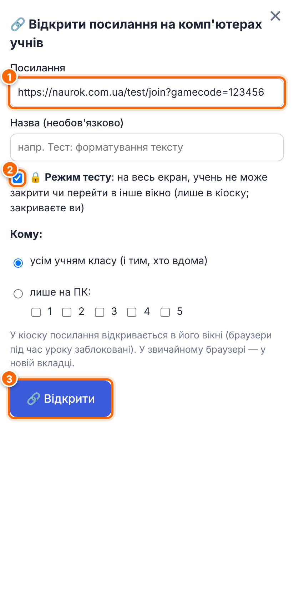

1. Вставте посилання (наприклад, тест «На Урок»).
2. **🔒 Режим тесту** — на ПК учнів вікно на весь екран, закрити його можете лише ви.
3. **🔗 Відкрити.**

**📤 Файли учням** — оберіть файли з пам'яті телефона (Завантаження, Google Диск, Telegram…) — вони з'являться в робочих папках учнів.

## 11. Журнал і оцінки

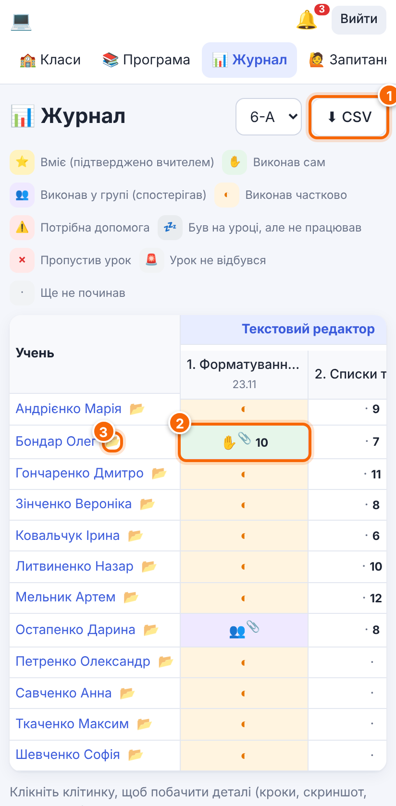

1. **⬇ CSV** — журнал зберігається в *Завантаження/InfoKlas*.
2. Клітинка учень × урок — торкніться, щоб поставити оцінку.
3. **📂** біля імені — папка учня.

Таблиця прокручується пальцем вбік і вниз; ім'я учня завжди видно зліва.

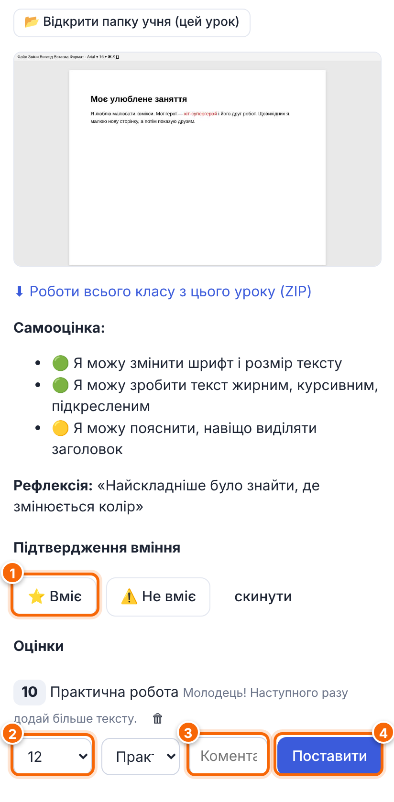

1. **⭐ Вміє.**
2. **Оцінка** 1–12.
3. **Коментар** для учня.
4. **Поставити** — учень отримає сповіщення.

## 12. Папка учня: перевірити роботу

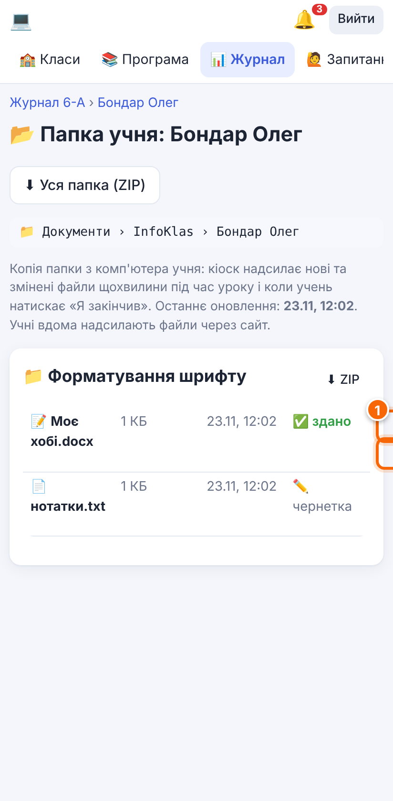

1. **👁 Переглянути** — документ Word, PDF, зображення чи текст відкривається прямо в додатку.
2. **⬇** — завантажити файл (Excel, PowerPoint, Scratch…) у *Завантаження/InfoKlas* і відкрити у відповідній програмі на телефоні.

## 13. Налаштування додатку

**⚙️ → 📱 Додаток:**

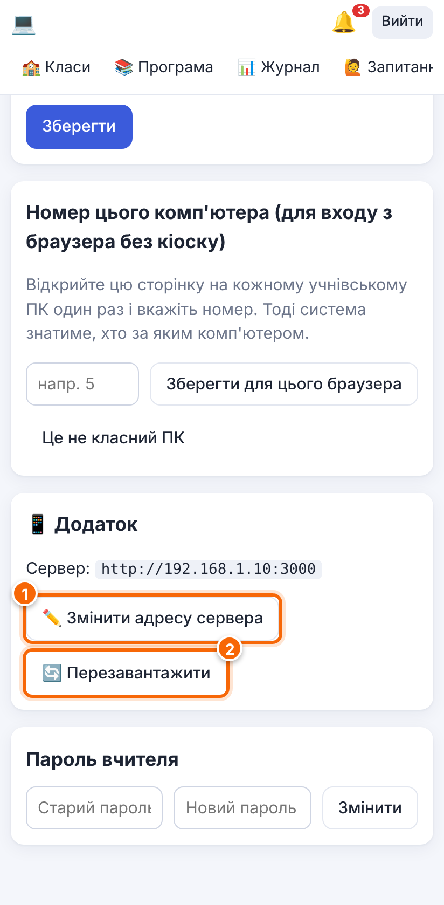

1. **Змінити адресу сервера** — наприклад, якщо школа перейшла на хмарний сервер.
2. **Перезавантажити** — оновити сторінку.

Якщо телефон не бачить сервер, додаток покаже:

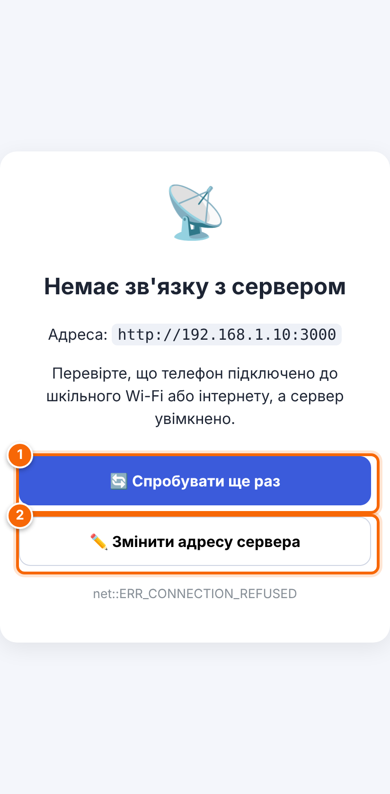

1. **Спробувати ще раз** — після підключення до Wi-Fi.
2. **Змінити адресу сервера.**

## 14. Поради та обмеження

- **Сповіщення у фоні.** Android може «приспати» згорнутий додаток, щоб зберегти заряд, — тоді сповіщення не прийде (події все одно будуть у 🔔). Щоб цього не траплялося: *Налаштування телефона → Додатки → ІнфоКлас → Батарея → «Без обмежень»* (назва пункту залежить від виробника).
- **Wi-Fi.** Якщо сервер у шкільній мережі, телефон має бути підключений саме до шкільного Wi-Fi. Мобільний інтернет до такого сервера не дістане.
- **Великі таблиці** (журнал, редактор уроку) зручніше переглядати, повернувши телефон горизонтально.
- **Безпека.** Не залишайте розблокований телефон учням: у додатку відкрито ваш кабінет вчителя. Вийти можна кнопкою **Вийти** вгорі.
- **Редагування уроків** працює й з телефона, але велику інструкційну картку зручніше готувати на комп'ютері.

## 15. Якщо щось не працює

| Проблема | Що зробити |
|---|---|
| «Немає зв'язку з сервером» | Перевірте Wi-Fi (шкільний?) і адресу сервера; спробуйте відкрити ту саму адресу в Chrome на телефоні. |
| Не приходять сповіщення | Дозвольте сповіщення: *Налаштування → Додатки → ІнфоКлас → Сповіщення*; батарея — «Без обмежень». |
| «Додаток не встановлено» під час оновлення | Нову версію підписано іншим ключем — видаліть старий додаток і встановіть новий. |
| Play Protect блокує встановлення | «Докладніше» → «Усе одно встановити». |
| Файл не завантажується | Перевірте вільне місце; файли зберігаються в *Завантаження/InfoKlas*. |
| «Трансляція екрана доступна лише з комп'ютера» | Так і є — використовуйте «📽 Презентація» або комп'ютер. |
| Не можу перетягнути учня на інший ПК | На телефоні: торкніться імені → «Посадити за ПК». |
| Сторінка виглядає «старою» | ⚙️ → 📱 Додаток → **Перезавантажити**. |
