# ІнфоКлас — Інструкція для учня

*Як увійти, виконати практичну роботу, отримати пояснення і здати роботу.*

---

## Мій урок за 6 кроків

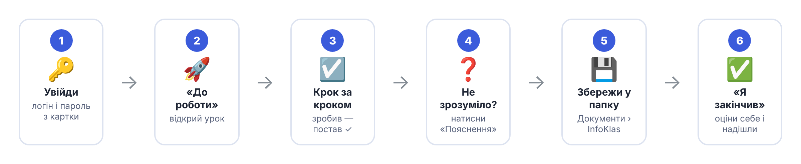

1. **Увійди** — логін і пароль з картки.
2. Натисни **«До роботи»**.
3. Виконуй **крок за кроком** і став ✓.
4. Не зрозуміло? Натисни **❓ Пояснення**.
5. **Збережи** роботу у свою папку.
6. Натисни **«Я закінчив»**.

---

## 1. Вхід

На комп'ютері в класі вгорі видно **номер твого комп'ютера**.

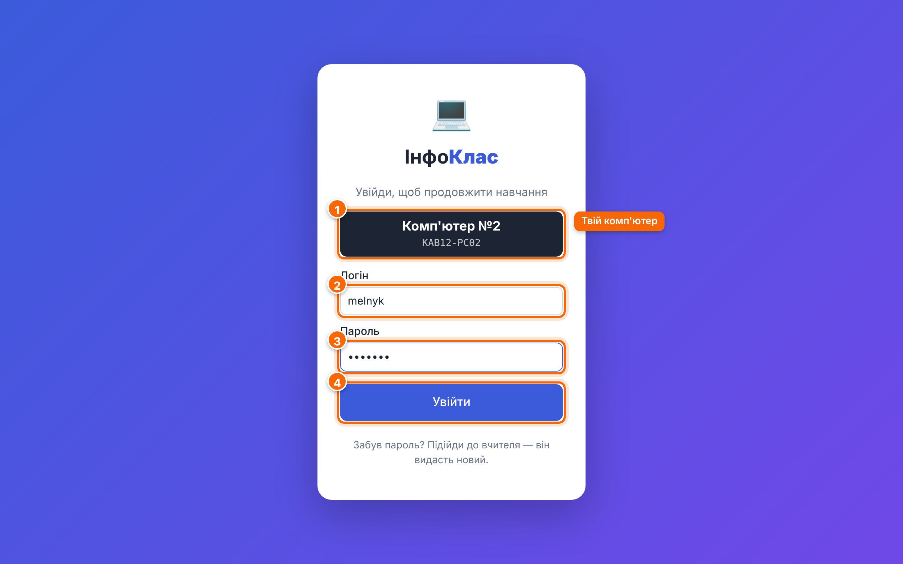

1. Номер комп'ютера і його ім'я — перевір, що ти сидиш саме за ним.
2. **Логін** — з картки (маленькими латинськими літерами).
3. **Пароль** — з картки (наприклад, `tiger47`).
4. **Увійти.**

> 🔑 **Забув пароль?** Підійди до вчителя — він видасть новий. Нікому не кажи свій пароль!

**Вдома** вхід такий самий — на сайті школи, з будь-якого комп'ютера чи телефона:

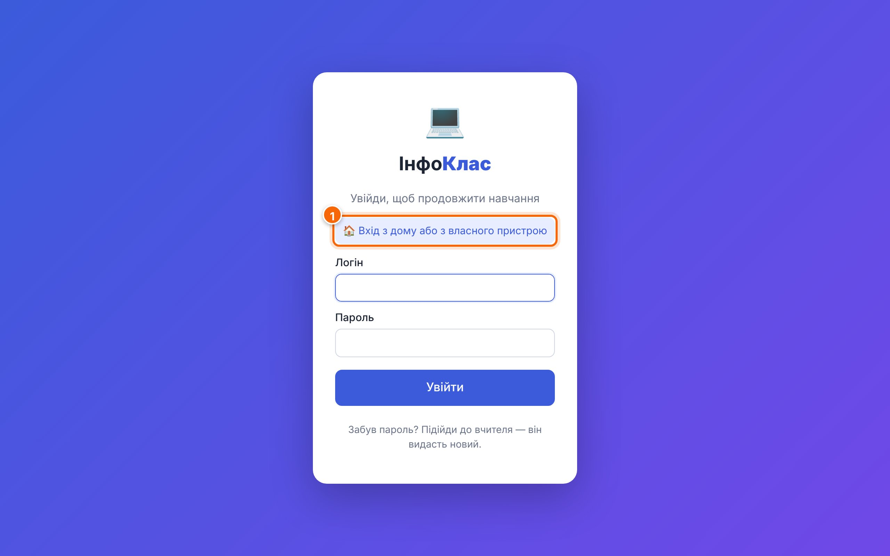

**Комп'ютер заблоковано?** Це нормально — зачекай, поки вчитель розблокує його.

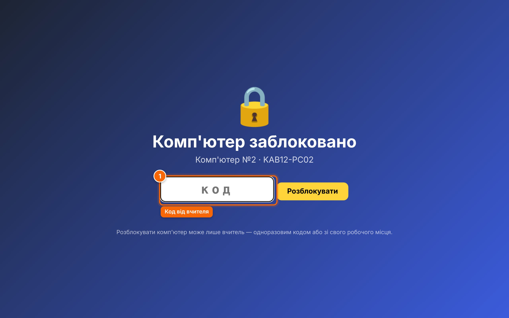

## 2. Мій шлях

Після входу ти бачиш свою головну сторінку.

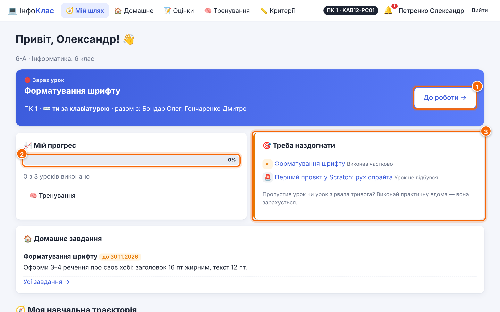

1. **Зараз урок** — тут написано твій ПК, твоя роль і з ким ти працюєш. Натисни **«До роботи →»**.
2. **Мій прогрес** — скільки уроків уже виконано.
3. **Треба наздогнати** — уроки, які ти пропустив або не завершив. Їх можна виконати вдома!

Нижче — **моя навчальна траєкторія**: що ми вивчаємо, навіщо, і де ти зараз.

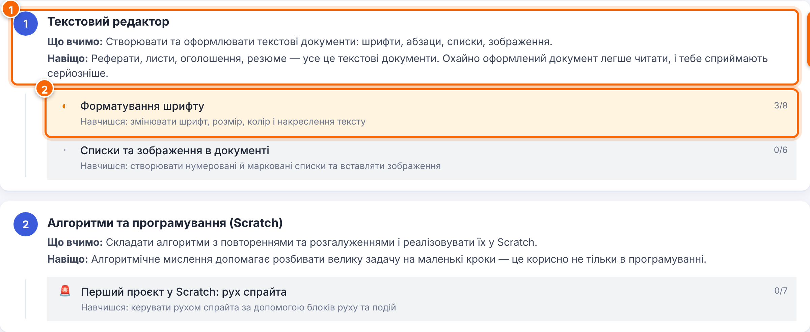

1. Тема: **що вчимо** і **навіщо** це потрібно.
2. Урок і твоя позначка.

Що означають позначки:

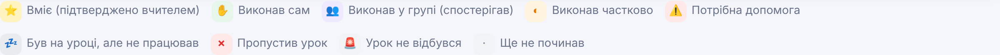

## 3. Урок

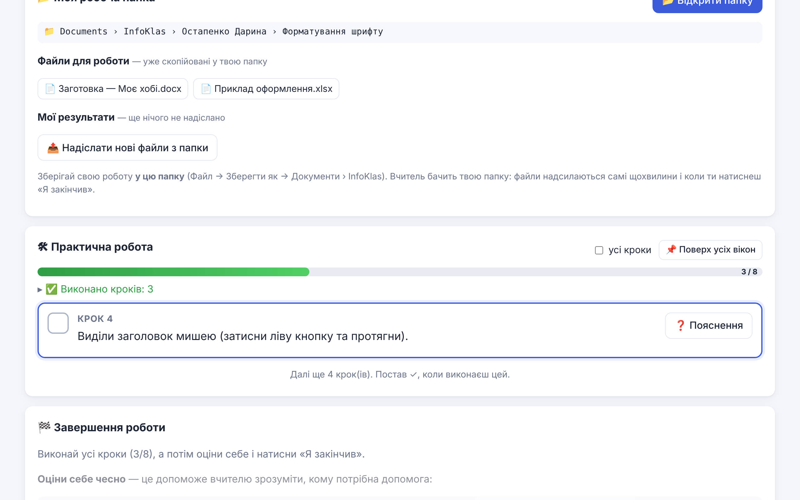

1. **Твій комп'ютер і група.** ⌨️ **Водій** — працює за клавіатурою. 🧭 **Штурман** — читає крок уголос і перевіряє. Посеред уроку ви поміняєтеся ролями!
2. **Мета уроку:** що ти навчишся, навіщо це, і **критерії успіху** — що ти зможеш наприкінці.

Нижче — **📖 Матеріали уроку**: конспект, відео, картинки.

## 4. Посилання і моя робоча папка

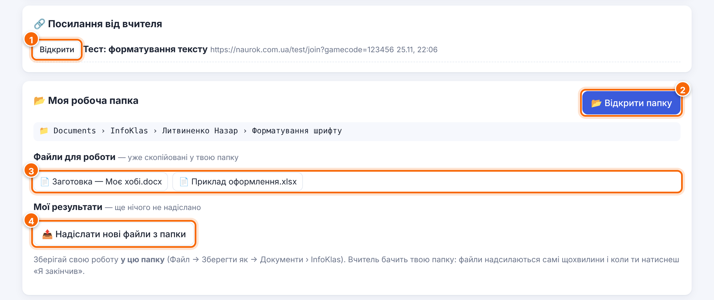

1. **Посилання від вчителя** (наприклад, тест) — вчитель відкриває їх сам, а тут вони лишаються, щоб відкрити ще раз.
2. **📂 Відкрити папку** — твоя особиста папка: `Документи › InfoKlas › Твоє ім'я › Урок`.
3. **Файли для роботи** — приклади та заготовки від вчителя. Вони **вже лежать у твоїй папці**.
4. **📤 Надіслати нові файли з папки** — надіслати вчителю те, що ти зберіг.

На комп'ютері в класі в цьому ж розділі є:
- **🧰 Програми** — кнопки Word, Excel, LibreOffice, Scratch тощо. Натисни — програма відкриється, а крок інструкції стане маленьким віконцем **поверх неї**.
- **Відкрити** біля файлу для роботи — заготовка одразу відкриється у Word чи Excel з твоєї папки.

> 💾 **Зберігай свою роботу саме в цю папку:** Файл → Зберегти як → Документи → InfoKlas → твоє ім'я → урок. Тоді вчитель її точно отримає!
>
> 👀 Вчитель бачить твою папку: нові та змінені файли надсилаються самі щохвилини, поки ти працюєш, і коли ти натискаєш «Я закінчив».

## 5. Практична робота: крок за кроком

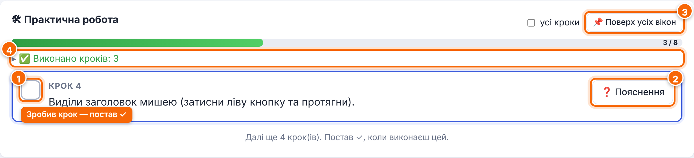

1. **Зробив крок — постав ✓.** Тоді з'явиться наступний.
   У кроці може бути **картинка** — так має виглядати твій екран. Натисни на неї, щоб збільшити. Якщо є **відео** — подивись його прямо в кроці.
2. **❓ Пояснення** — якщо незрозуміло.
3. **📌 Поверх усіх вікон** — маленьке віконце з кроком над Word, Scratch чи іншою програмою:

   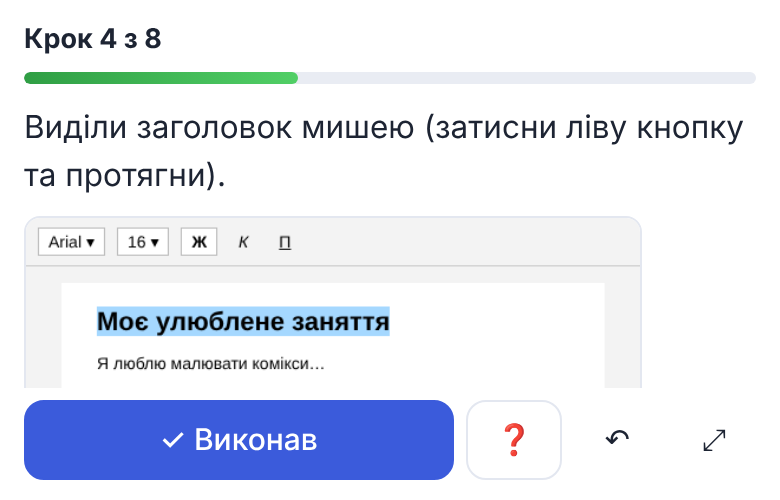

   Натискай **✓ Виконав** прямо в ньому, **↶** — повернутися на крок назад, **⤢** — розгорнути.
4. **Виконані кроки** — можна розгорнути й переглянути.

> Якщо ви працюєте вдвох-утрьох, ✓ зараховується **всій групі**.

## 6. Не зрозуміло? Пояснення

Натисни **❓ Пояснення** біля кроку. Спочатку подивись, чи немає вже пояснення від вчителя:

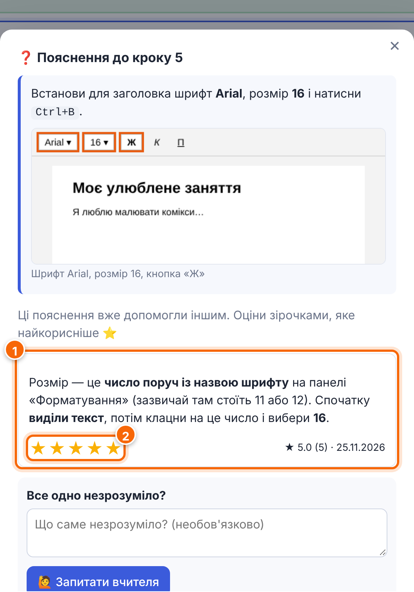

1. Пояснення від вчителя.
2. **★ Оціни**, наскільки воно допомогло — найкращі пояснення побачать інші учні.

Якщо пояснення немає або не допомогло — **запитай вчителя**:

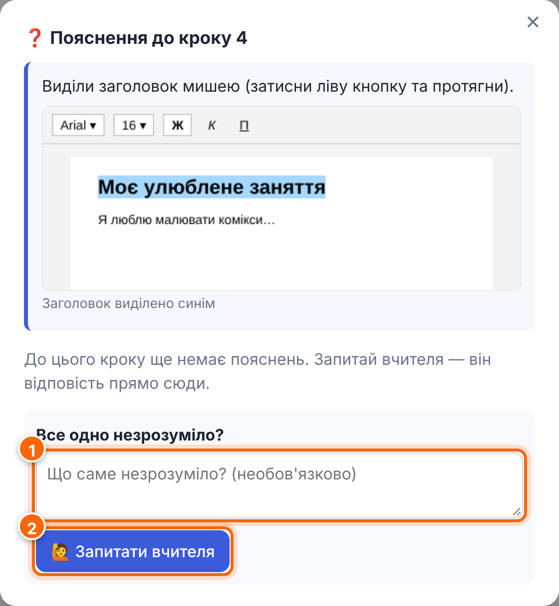

1. Напиши, що саме незрозуміло (можна не писати).
2. **🙋 Запитати вчителя.**

Коли вчитель відповість, з'явиться віконце:

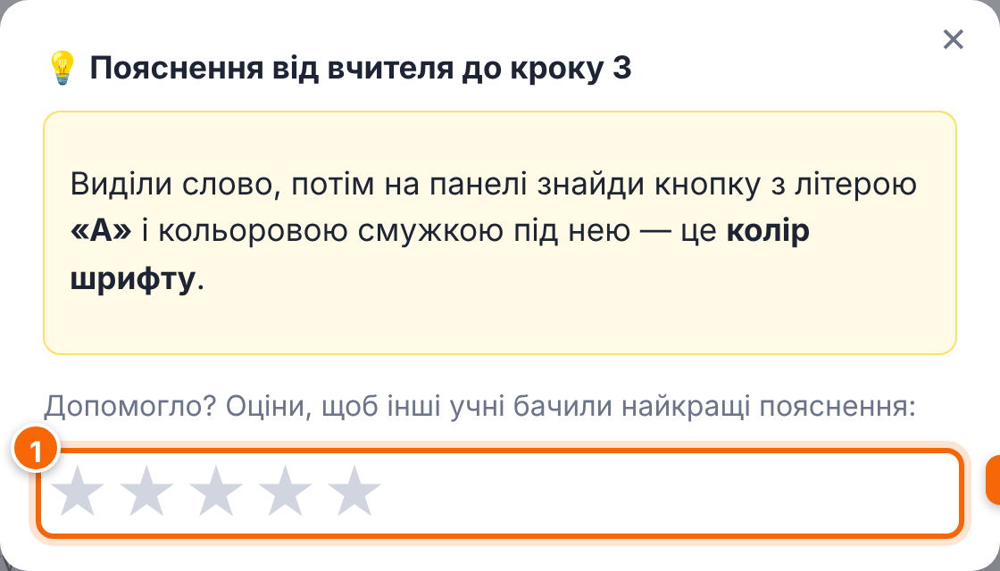

1. Оціни пояснення зірочками ★.

## 7. Коли вчитель показує

Під час презентації чи режиму **«Увага!»** екран заблокований — дивись на вчителя.

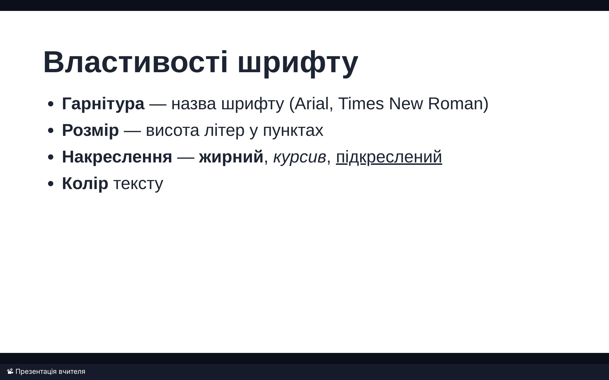

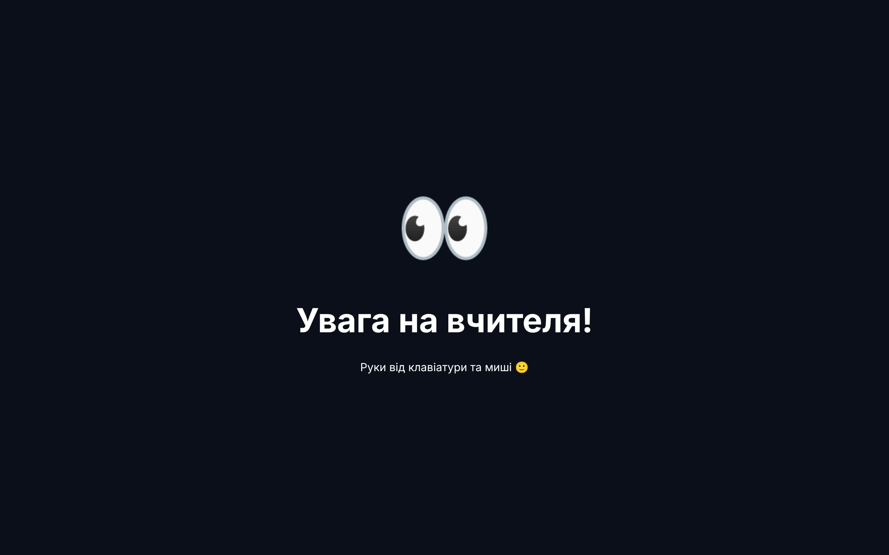

## 8. «Я закінчив»

Коли всі кроки виконано, внизу сторінки:

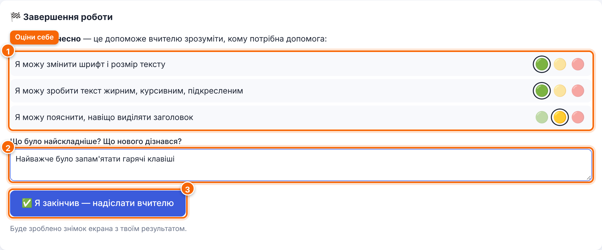

1. **Оціни себе чесно** за кожним критерієм: 🟢 можу · 🟡 не впевнений · 🔴 ще не можу.
2. Напиши, **що було найскладніше** і що нового ти дізнався.
3. Натисни **✅ Я закінчив — надіслати вчителю.**

Відкрий свою роботу на екрані — буде зроблено знімок:

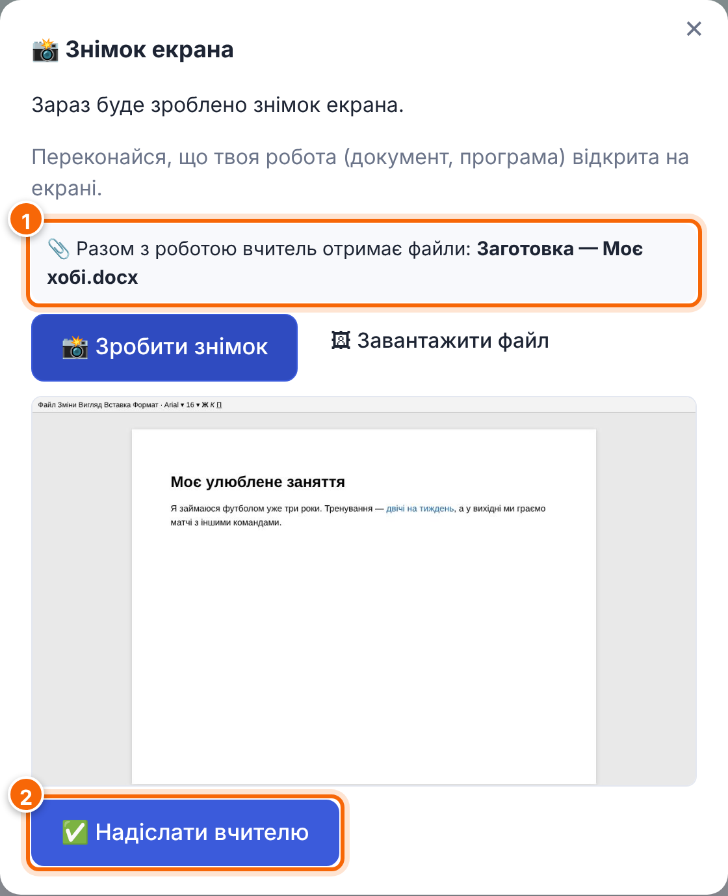

1. Тут видно, **які файли з твоєї папки** отримає вчитель. Якщо написано «⚠️ немає нових файлів» — збережи роботу в папку!
2. **✅ Надіслати вчителю.**

## 9. Вдома: наздогнати пропущене

Пропустив урок або урок зірвала тривога? На головній — **«Треба наздогнати»**:

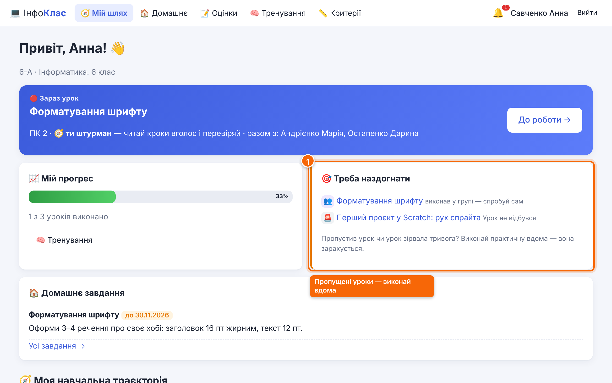

1. Відкрий урок і виконай його так само: кроки, ✓, «Я закінчив». Він зарахується!

Файли для роботи вдома:

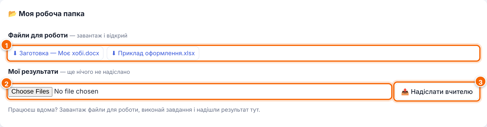

1. **⬇ Завантаж** файли для роботи.
2. Обери свій готовий файл.
3. **📤 Надіслати вчителю.**

## 10. Домашнє, оцінки, тренування, критерії

**🏠 Домашнє:**

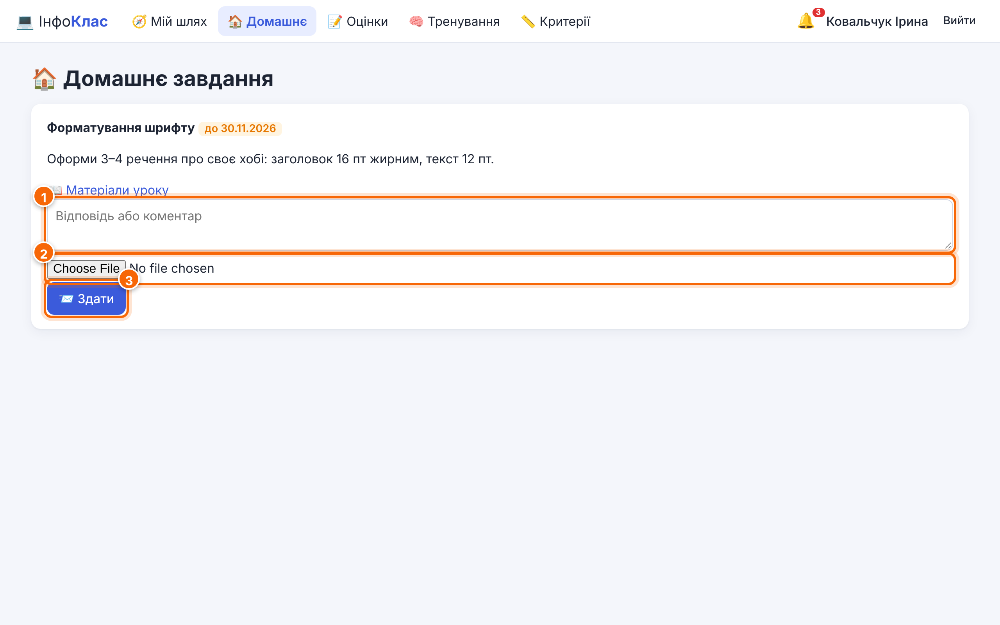

1. Відповідь або коментар.
2. Файл з роботою.
3. **📨 Здати.**

**📝 Оцінки** — оцінка і **коментар вчителя**, що вийшло добре і що покращити:

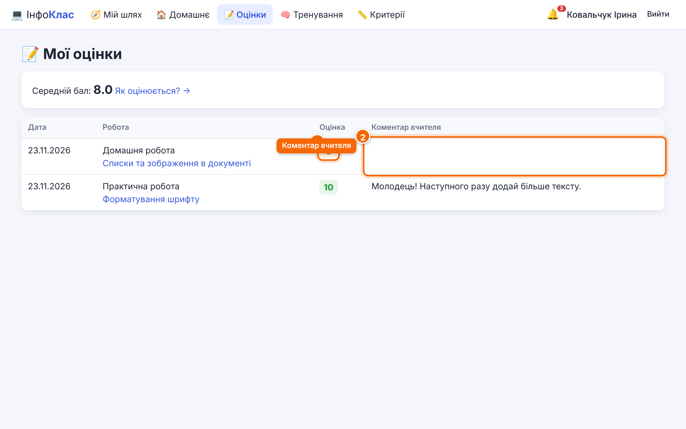

**🧠 Тренування** — короткі запитання з уроків, які ти вже проходив. Що краще знаєш — то рідше питання повертається.

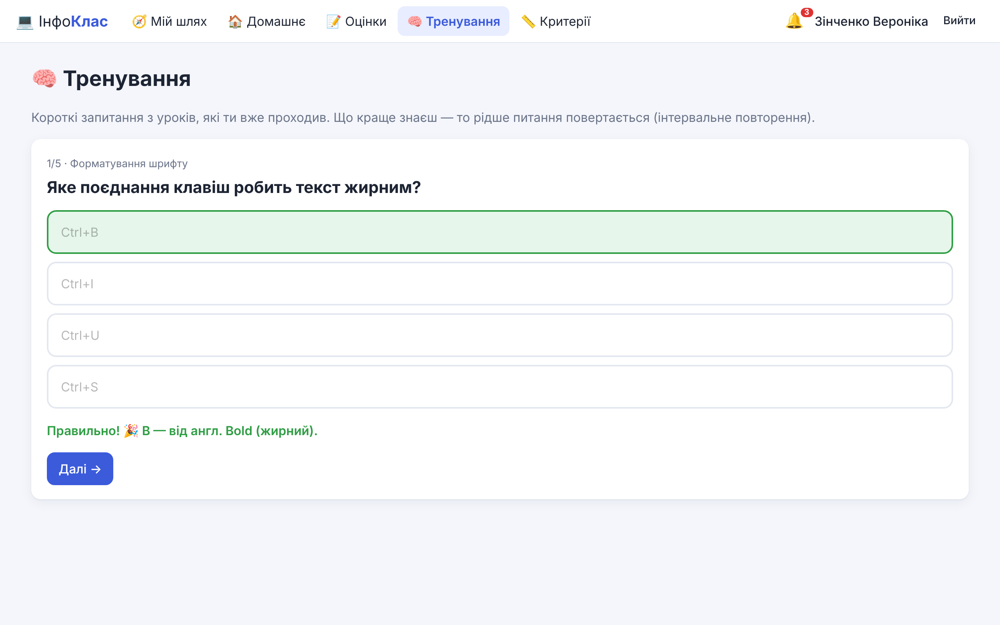

**📏 Критерії** — як оцінюється робота:

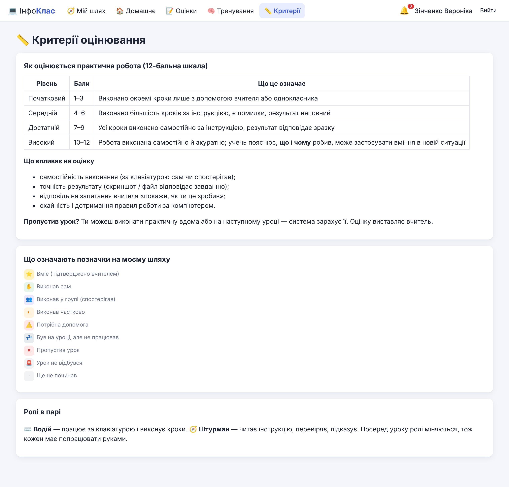

---

## Правила

- ✅ Входь **лише під своїм** логіном.
- ✅ Читай крок **до кінця**, потім виконуй, потім став ✓.
- ✅ Зберігай роботу в **свою папку InfoKlas**.
- ✅ Оцінюй себе **чесно** — це допомагає вчителю допомогти тобі.
- ❌ Не відкривай ігри й браузери під час уроку — комп'ютер закриє їх сам, а вчитель про це дізнається.

**Щось не так?** Підніми руку або натисни **❓ Пояснення** 🙂
