# ІнфоКлас — Інструкція вчителя

*Підготовка курсу, проведення уроку, файли й посилання для учнів, журнал і оцінювання.*

---

## Зміст
1. [Урок за 6 кроків](#1-урок-за-6-кроків)
2. [Вхід і головна сторінка](#2-вхід-і-головна-сторінка)
3. [Класи й учні: логіни, паролі, картки](#3-класи-й-учні-логіни-паролі-картки)
4. [Програма: курс, теми, уроки](#4-програма-курс-теми-уроки)
5. [Підготовка уроку: кроки, матеріали, файли для роботи](#5-підготовка-уроку-кроки-матеріали-файли-для-роботи)
6. [Почати урок](#6-почати-урок)
7. [Урок наживо: що де на екрані](#7-урок-наживо-що-де-на-екрані)
8. [Присутність, розсадка і ролі](#8-присутність-розсадка-і-ролі)
9. [Режими: презентація, мій екран, увага](#9-режими-презентація-мій-екран-увага)
10. [Відкрити посилання (тест) на ПК учнів](#10-відкрити-посилання-тест-на-пк-учнів)
11. [Надіслати файли учням](#11-надіслати-файли-учням)
12. [Відповіді на запитання учнів](#12-відповіді-на-запитання-учнів)
13. [Завершені роботи, тривога, кінець уроку](#13-завершені-роботи-тривога-кінець-уроку)
14. [Журнал, оцінки, вміння](#14-журнал-оцінки-вміння)
    - [Папка учня: перевірити документи вручну](#папка-учня-перевірити-документи-вручну)
15. [Роботи, домашні завдання, профіль учня](#15-роботи-домашні-завдання-профіль-учня)
16. [Поради з методики](#16-поради-з-методики)

---

## 1. Урок за 6 кроків

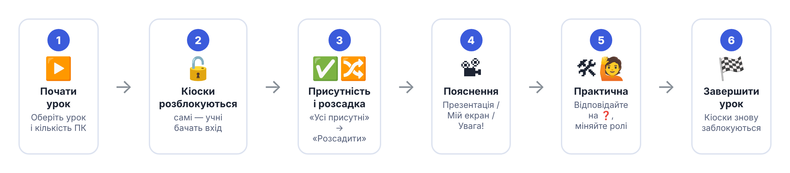

1. **▶ Почати урок** — оберіть урок і скільки комп'ютерів працює сьогодні.
2. Кіоски на учнівських ПК **розблоковуються самі** (вони стартують, коли учень входить у Windows/Linux). Якщо кіоск не запущено — Veyon → «Запустити програму» (команда — на сторінці 🔒 Комп'ютери).
3. **✅ Усі присутні** → відмітьте відсутніх → **🔀 Розсадити автоматично**.
4. **Пояснення:** 📽 Презентація, 📺 Мій екран або 👀 Увага!
5. **🛠 Практична:** учні виконують кроки, ви відповідаєте на 🙋, посередині — 🔄 Поміняти ролі.
6. **🏁 Завершити урок** — кіоски знову заблокуються.

## 2. Вхід і головна сторінка

Відкрийте адресу системи (її дасть адміністратор) і увійдіть своїм логіном і паролем.

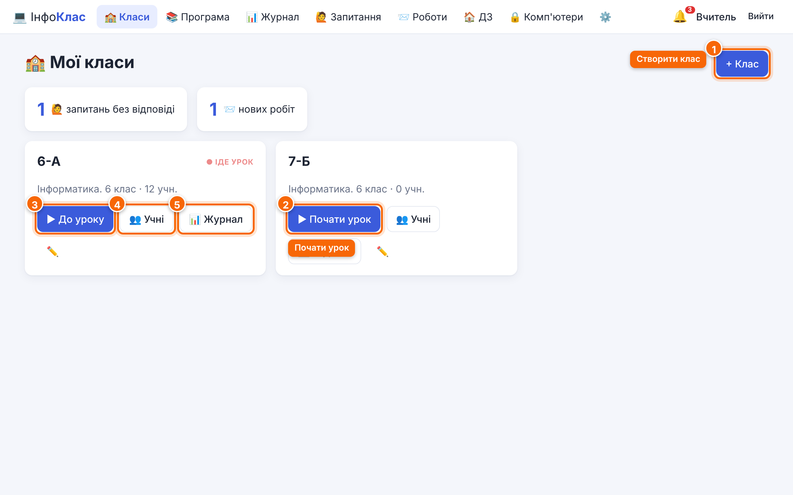

1. **+ Клас** — створити клас і призначити йому курс.
2. **▶ Почати урок** для класу.
3. **▶ До уроку** — якщо урок уже йде.
4. **👥 Учні** — список, паролі, картки.
5. **📊 Журнал** класу.

Угорі — лічильники **🙋 запитань без відповіді** та **📨 нових робіт**, а 🔔 — сповіщення (запитання, завершені роботи, здані ДЗ).

## 3. Класи й учні: логіни, паролі, картки

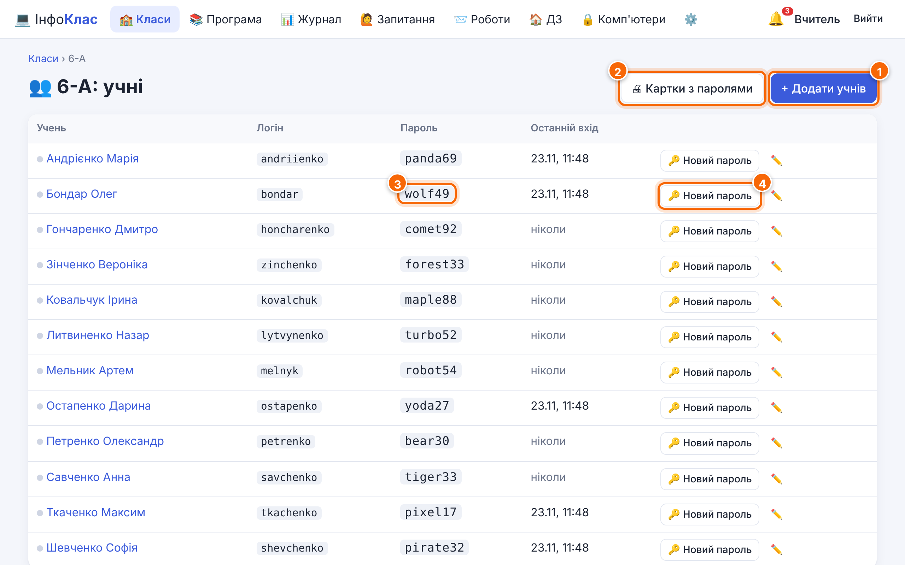

1. **+ Додати учнів** — вставте список «Прізвище Ім'я», кожен з нового рядка:

   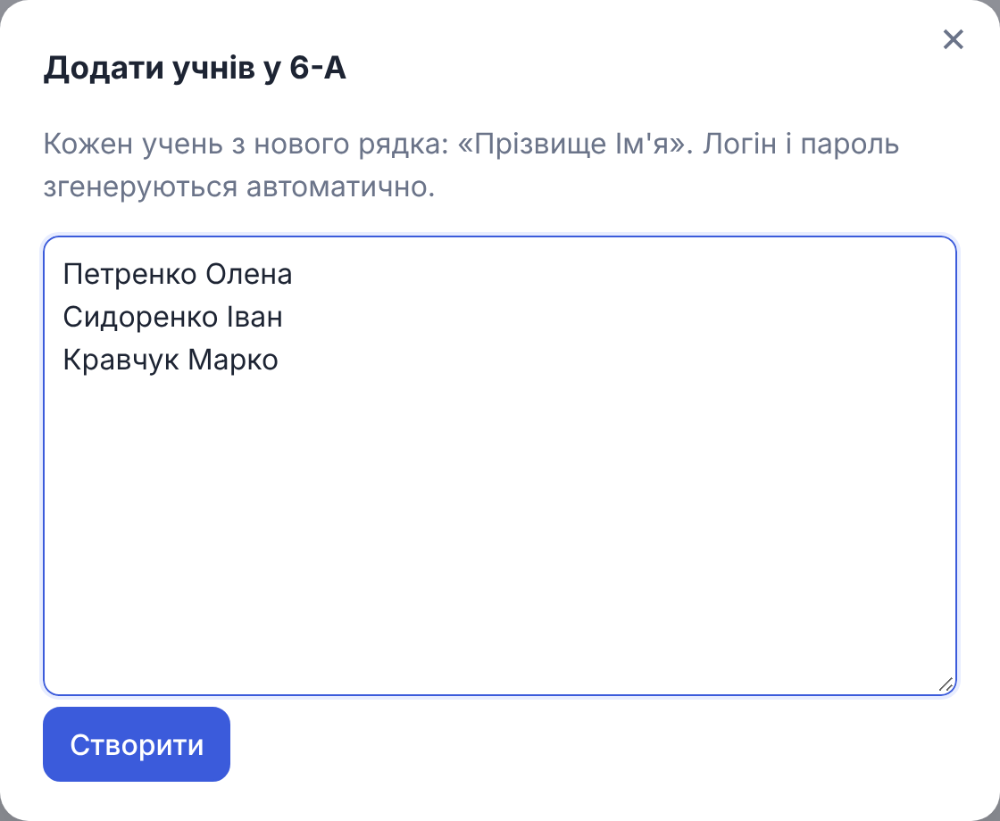

   Логін і пароль (на кшталт `tiger47`) згенеруються автоматично — e-mail не потрібен.
2. **🖨 Картки з паролями** — друк карток, які можна роздати й вклеїти в зошит:

   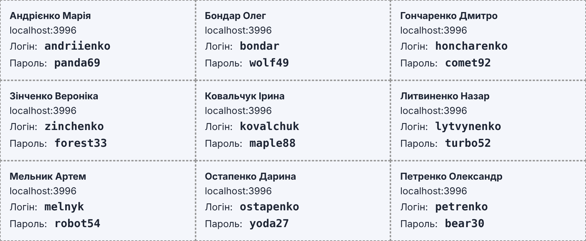

3. Пароль учня завжди видно вам у таблиці.
4. **🔑 Новий пароль** — якщо учень загубив картку (старий пароль перестає діяти).

Нижче на сторінці класу — **історія уроків**: дата, урок, статус (✓ проведено / 🚨 не відбувся), кількість присутніх.

## 4. Програма: курс, теми, уроки

**📚 Програма → курс.**

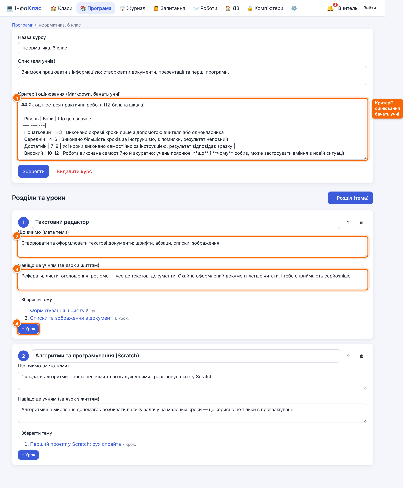

1. **Критерії оцінювання** — бачать учні у своєму кабінеті (Markdown: таблиці, списки, **жирний**).
2. **Що вчимо** — мета теми.
3. **Навіщо** — зв'язок з життям (учні бачать це на «Моєму шляху»).
4. **+ Урок** у темі.

## 5. Підготовка уроку: кроки, матеріали, файли для роботи

Клацніть на урок у курсі — відкриється редактор.

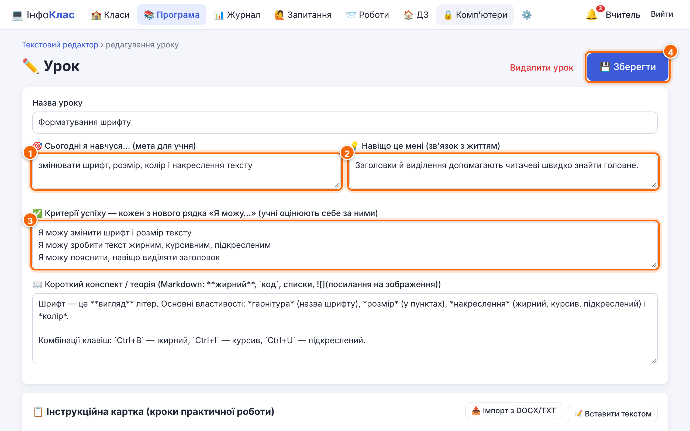

1. **Сьогодні я навчуся…** — мета для учня.
2. **Навіщо це мені.**
3. **Критерії успіху** — кожен з нового рядка «Я можу…». Наприкінці учні оцінюють себе за ними (🟢🟡🔴).
4. **💾 Зберегти** — не забувайте!

### Інструкційна картка (кроки)

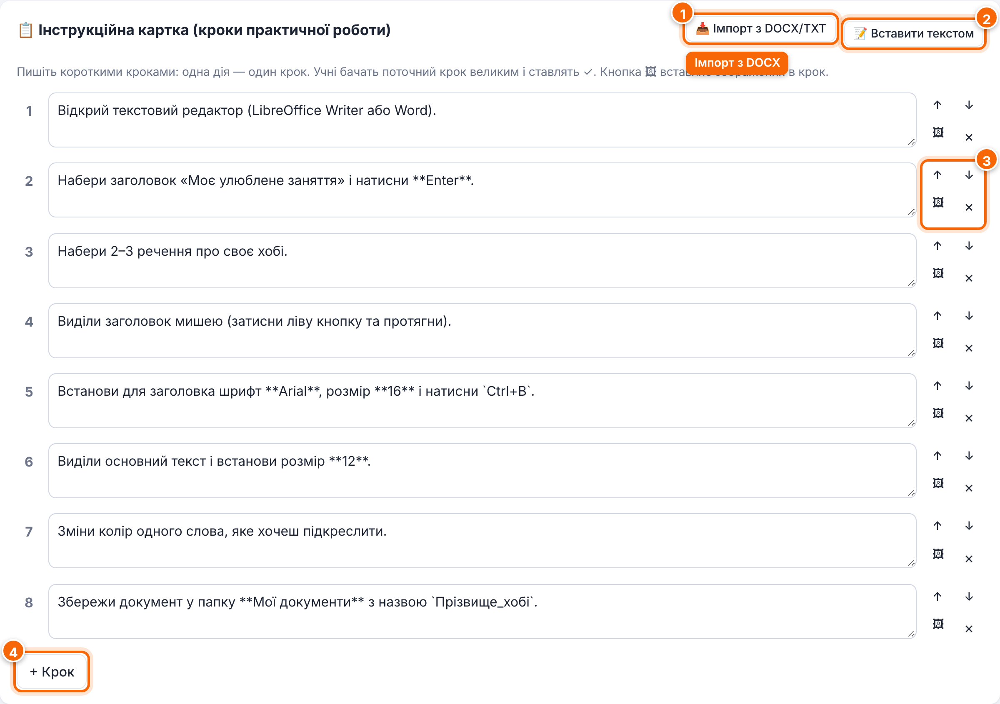

1. **📥 Імпорт з DOCX/TXT** — кожен пункт нумерованого списку стане кроком. **Картинки з картки переносяться автоматично** й прив'язуються до кроку, під яким вони стоять у документі.
2. **📝 Вставити текстом** — кожен рядок = крок.
3. **Зображення й відео кроку** — показуються мініатюрами під текстом. ✕ прибирає, у полі під мініатюрою можна написати підпис.
4. **Додати до кроку:**
   - **🖼 Зображення** — один або кілька файлів;
   - **🎬 Відео** — файл `.mp4`/`.webm` (наприклад, запис екрана з демонстрацією дії);
   - **▶ YouTube** — посилання на відео;
   - **скриншот через Ctrl+V** — зробіть знімок (Win+Shift+S у Windows, PrtSc у Linux) і просто вставте його в поле кроку;
   - або **перетягніть файл** мишею на крок.
5. ↑ ↓ — змінити порядок кроків, ✕ — видалити крок.
6. **+ Крок.**

Учні бачать зображення у кроці й можуть збільшити його кліком, а відео відтворюють прямо в кроці.

> **Порада.** Одна дія — один крок, і до складного кроку — скриншот того, що учень має побачити на екрані. Учні бачать **поточний крок великим** і не можуть «проскочити» інструкцію — кожен крок треба відмітити ✓.

### Матеріали та файли для роботи

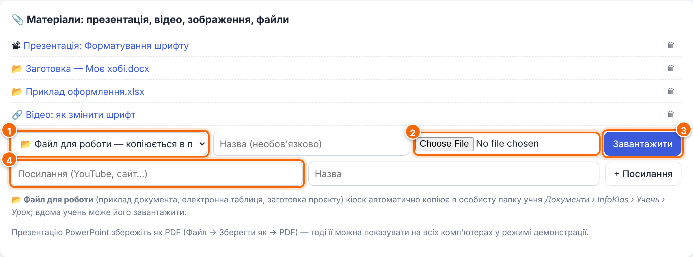

1. **Тип матеріалу:**
   - 📽 **Презентація (PDF)** — її можна показувати на всіх ПК у режимі демонстрації (PowerPoint → Зберегти як → PDF);
   - 🎬 відео, 🖼 зображення, 📋 інструкційна картка, 📎 файл для перегляду;
   - 📂 **Файл для роботи** — приклад документа, електронна таблиця, заготовка: кіоск **сам копіює його в особисту папку кожного учня** `Документи › InfoKlas › Учень › Урок`.
2. Оберіть файл.
3. **Завантажити.**
4. Посилання (YouTube, сайт) — додається кнопкою **+ Посилання**.

### Питання для тренування

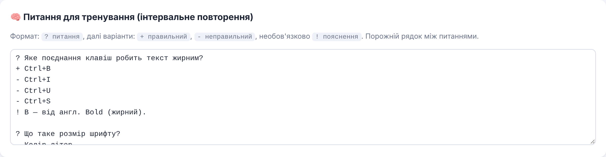

Формат: `? питання`, далі `+ правильна відповідь`, `- неправильна`, за бажанням `! пояснення`. Учні повторюють ці питання у розділі **🧠 Тренування** — система сама підбирає, що повторити (інтервальне повторення).

## 6. Почати урок

На сторінці **Класи** → **▶ Почати урок**:

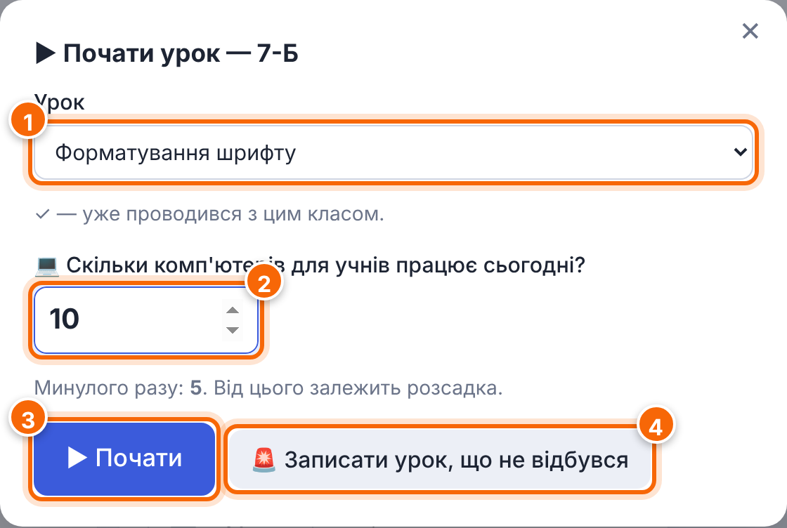

1. **Урок** (✓ — уже проводився з цим класом).
2. **Скільки комп'ютерів працює сьогодні** — питається щоразу (10 цього тижня, 7 наступного — без проблем).
3. **▶ Почати.**
4. **🚨 Записати урок, що не відбувся** — якщо урок зірвала тривога: учні побачать його в «Треба наздогнати».

Кіоски на учнівських ПК розблокуються самі. Якщо на якомусь ПК кіоск не запущено (сіра 🖥 на картці) — запустіть його через **Veyon** (команда — на сторінці 🔒 Комп'ютери).

## 7. Урок наживо: що де на екрані

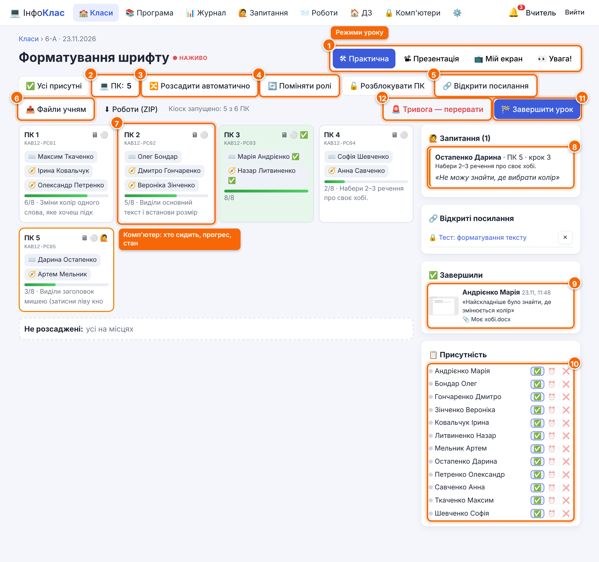

| № | Що це |
|---|---|
| 1 | **Режими:** 🛠 Практична · 📽 Презентація · 📺 Мій екран · 👀 Увага! |
| 2 | **💻 ПК: 5** — змінити кількість комп'ютерів посеред уроку (зламався ПК) |
| 3 | **🔀 Розсадити автоматично** |
| 4 | **🔄 Поміняти ролі** — водій ⌨️ ↔ штурман 🧭 |
| 5 | **🔗 Відкрити посилання** на ПК учнів (тест) |
| 6 | **📤 Файли учням** — у їхні робочі папки |
| 7 | **Картка комп'ютера** — хто сидить, прогрес кроків, поточний крок, стан |
| 8 | **🙋 Запитання** учнів — клацніть, щоб відповісти |
| 9 | **✅ Завершили** — знімки екрана, файли, рефлексія |
| 10 | **📋 Присутність** — ✅ був · ⏰ запізнився · ❌ відсутній |
| 11 | **🏁 Завершити урок** |
| 12 | **🚨 Тривога — перервати** |

Поруч також **🔓 Розблокувати ПК**, **⬇ Роботи (ZIP)** (усі файли класу по папках учнів) і підсумок «Кіоск запущено: 5 з 6 ПК».

**Картка комп'ютера:**

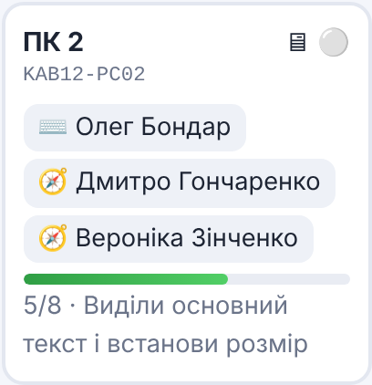

- `KAB12-PC02` — ім'я комп'ютера в Windows/Linux (як у Veyon);
- 🖥 — кіоск запущено (сіра — не запущено), 🟢 — учень у системі, 🙋 — є запитання, ✅ — завершив, ⚠️ — вийшов з вікна демонстрації;
- ⌨️ — за клавіатурою (водій), 🧭 — штурман;
- смужка — скільки кроків виконано, і текст поточного кроку.

## 8. Присутність, розсадка і ролі

1. **✅ Усі присутні**, потім ❌ для відсутніх (учень, що увійшов за ПК, відмічається сам).
2. **🔀 Розсадити автоматично.** За клавіатуру першими сідають ті, **хто найменше працював руками** і хто **пропустив минулий урок**; групи змішуються за рівнем, вчорашні пари не повторюються.
3. Пересадити — **перетягніть** ім'я на іншу картку ПК.
4. Посеред уроку — **🔄 Поміняти ролі**: учні отримають сповіщення.

Клік на ім'я учня:

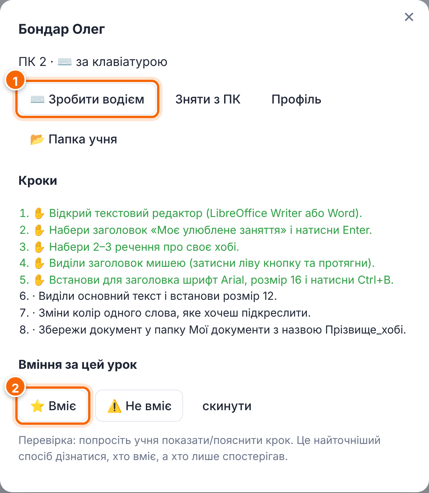

1. **⌨️ Зробити водієм.**
2. **⭐ Вміє / ⚠️ Не вміє** — підтвердження після короткої перевірки («покажи, як ти це зробив»).

> **Важливо.** Кроки, виконані за комп'ютером, зараховуються **всій групі**, але окремо видно, хто був за клавіатурою (✋ «виконав сам»), а хто спостерігав (👥 «у групі»). Так легко побачити, кому треба дати попрацювати самостійно.

## 9. Режими: презентація, мій екран, увага

**📽 Презентація** — PDF з матеріалів уроку на всіх екранах:

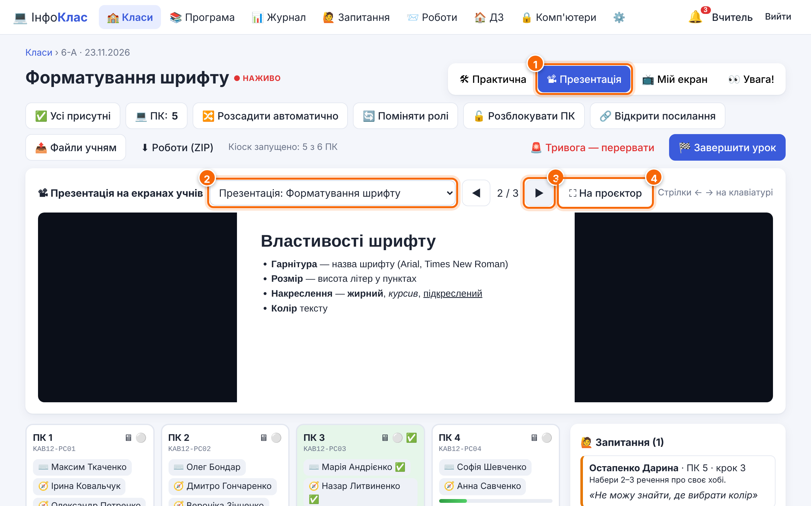

1. Режим «Презентація».
2. Вибір файлу.
3. ◀ ▶ — гортати (або стрілки на клавіатурі).
4. **⛶ На проєктор.**

Що бачать учні (вийти з цього екрана в кіоску не можна):

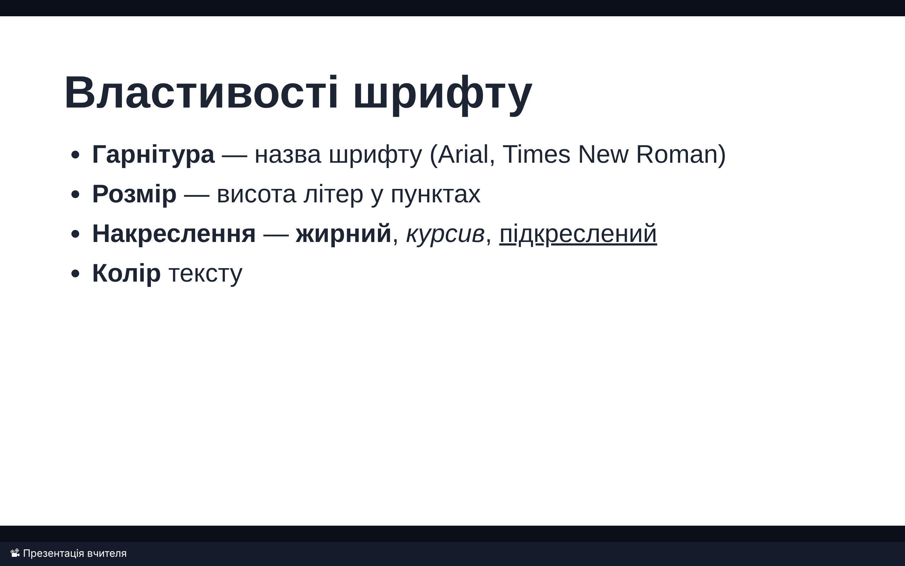

**📺 Мій екран** — трансляція вашого екрана на всі ПК (браузер попросить обрати екран).

**👀 Увага!** — усі екрани заблоковані:

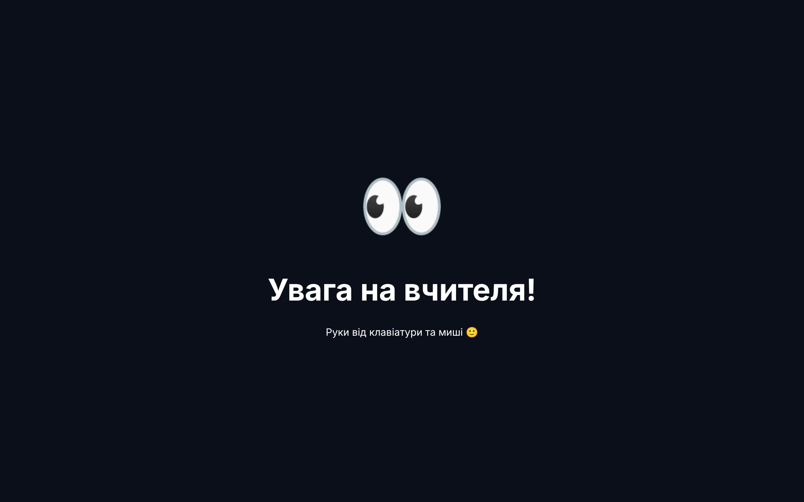

Повернутися до роботи — **🛠 Практична**.

> Veyon також уміє блокувати екрани й транслювати — користуйтеся тим, що зручніше.

## 10. Відкрити посилання (тест) на ПК учнів

**🔗 Відкрити посилання:**

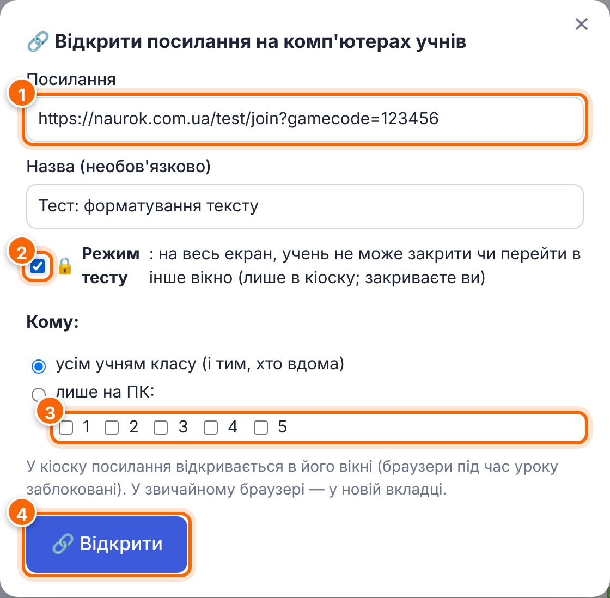

1. Посилання (наприклад, тест «На Урок»).
2. **🔒 Режим тесту** — вікно на весь екран, учень не може його закрити чи перейти в інше вікно (лише в кіоску).
3. Кому: **усім** (і тим, хто вдома) або **лише вибраним ПК**.
4. **🔗 Відкрити.**

Відкриті посилання видно справа на сторінці уроку; **✕** закриває їх на ПК учнів. Посилання також лишаються на сторінці уроку в учнів — запізнілі й ті, хто вдома, можуть відкрити їх пізніше.

## 11. Надіслати файли учням

**📤 Файли учням** — оберіть один або кілька файлів:

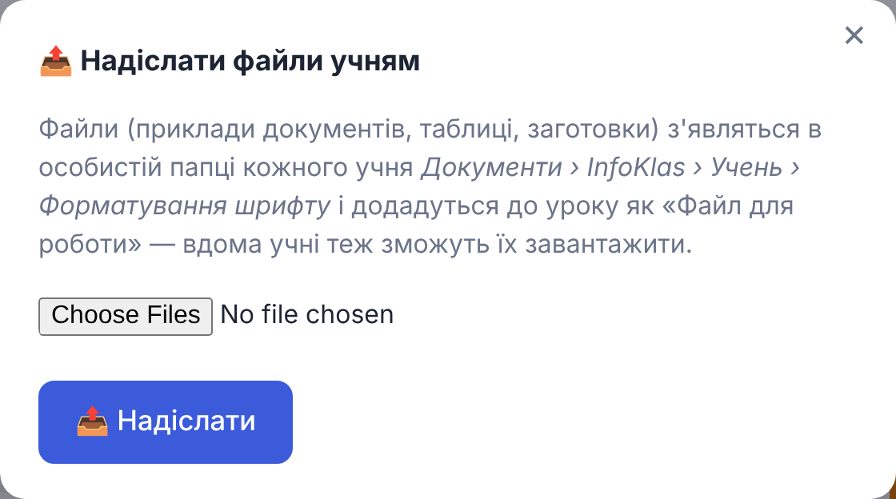

Файли **одразу з'являються в робочих папках учнів** `Документи › InfoKlas › Учень › Урок` і додаються до уроку як «Файл для роботи» (вдома їх теж можна завантажити). Якщо учень уже почав редагувати свою копію — вона не перезаписується.

## 12. Відповіді на запитання учнів

Учень тисне **❓ Пояснення** біля кроку. Спочатку він бачить ваші **попередні пояснення** (найкращі за ⭐ зверху) і лише потім може запитати вас. Запитання з'являється справа (🙋) і в сповіщеннях.

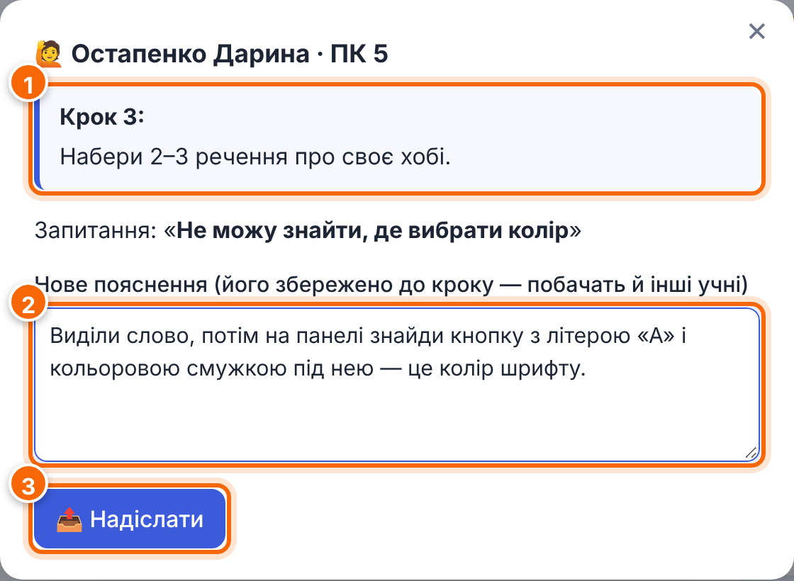

1. Крок, до якого запитання, і текст запитання.
2. Напишіть пояснення (можна **жирний**, `код`) — або надішліть **вже наявне** одним кліком.
3. **📤 Надіслати** — учень одразу отримає спливне вікно.

Пояснення **зберігається до кроку** — його побачать і інші учні. Одна відповідь закриває однакові запитання кількох учнів.

## 13. Завершені роботи, тривога, кінець уроку

Учень тисне **«Я закінчив»** → оцінює себе, пише рефлексію → кіоск робить **знімок екрана** і забирає **файли з його робочої папки**. Ви отримуєте сповіщення, а робота з'являється в блоці **✅ Завершили**:

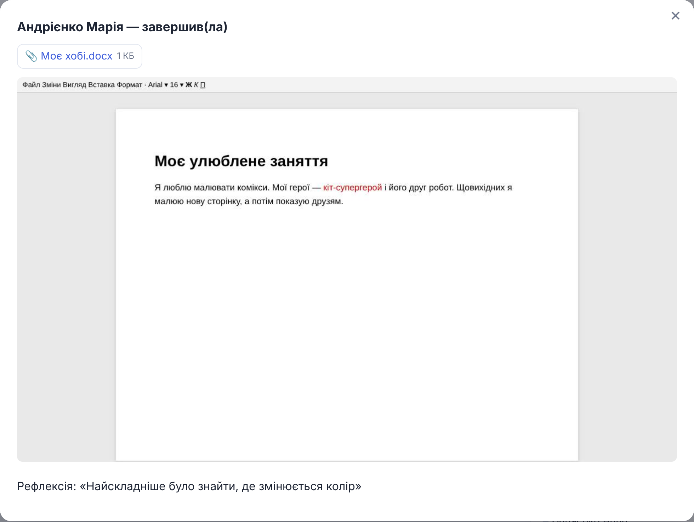

- **🚨 Тривога — перервати** — урок позначається як перерваний, прогрес зберігається, учні отримують сповіщення, що можуть доробити вдома.
- **🏁 Завершити урок** — неприсутні записуються як відсутні, кіоски знову блокуються.
- **⬇ Роботи (ZIP)** — усі файли та знімки класу одним архівом, по папках учнів.

## 14. Журнал, оцінки, вміння

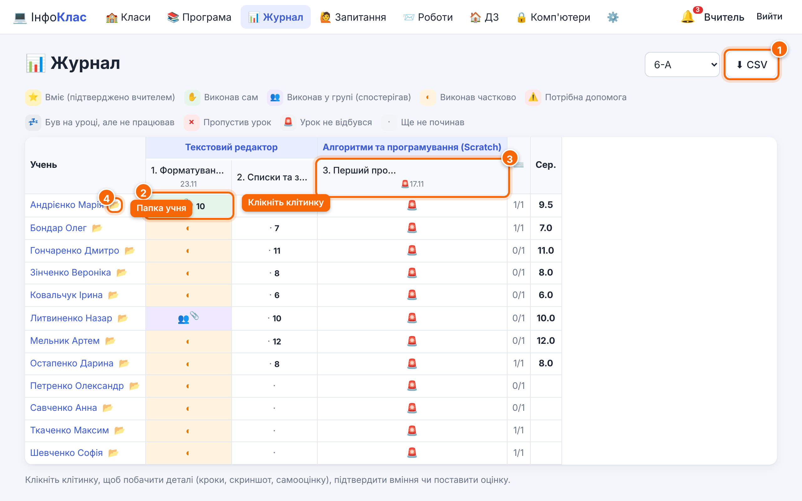

1. **⬇ CSV** — для Excel.
2. Клітинка учень × урок — клікніть, щоб побачити деталі.
3. Під назвою уроку — дати проведення, 🚨 — урок не відбувся.
4. **📂 біля імені** — папка учня з його документами (див. нижче).

**Позначки:** ⭐ вміє (підтверджено) · ✋ виконав сам · 👥 у групі (спостерігав) · ◐ частково · ⚠️ потрібна допомога · 💤 був, але не працював · ✗ пропустив · 🚨 урок не відбувся · 📎 є файли · 🏠 виконував вдома. Стовпець **⌨️** — скільки разів учень був за клавіатурою.

**Клітинка журналу:**

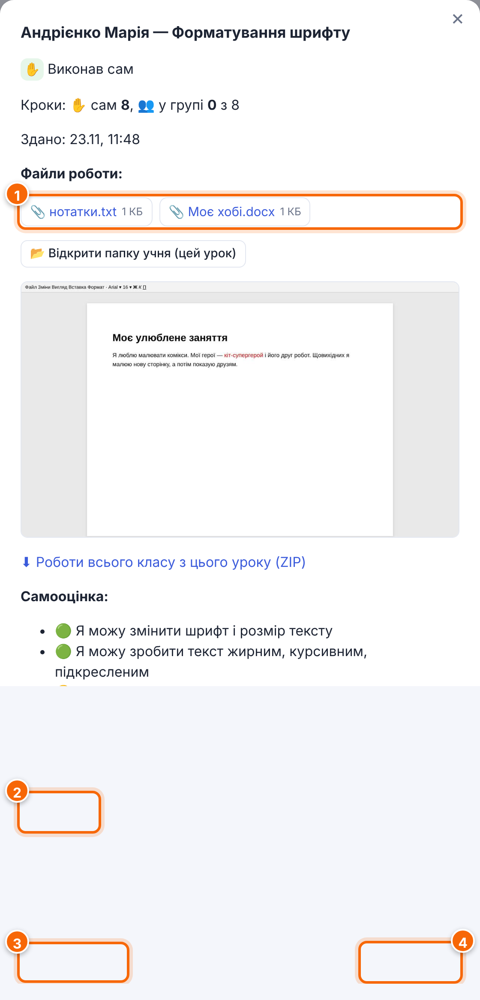

1. **Файли роботи** (клік — завантажити), знімок екрана, самооцінка, рефлексія.
2. **⭐ Вміє / ⚠️ Не вміє.**
3. **Оцінка** 1–12, вид роботи, коментар для учня.
4. **Поставити** — учень отримає сповіщення.

Внизу вікна — кнопка **📂 Відкрити папку учня (цей урок)**:

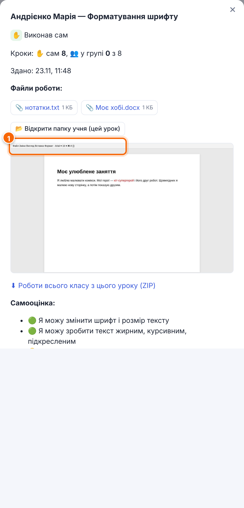

### Папка учня: перевірити документи вручну

У кожного учня на комп'ютері в класі є особиста папка `Документи › InfoKlas › Учень › Урок`. Кіоск **сам надсилає її копію на сервер**: щохвилини під час уроку (тихо, без сповіщень) і коли учень тисне «Я закінчив». Тому ви бачите документи учня **ще до того, як він здав роботу**.

Відкрити папку можна з журналу (📂 біля імені або в клітинці), з профілю учня та з уроку наживо (клік на ім'я → 📂 Папка учня).

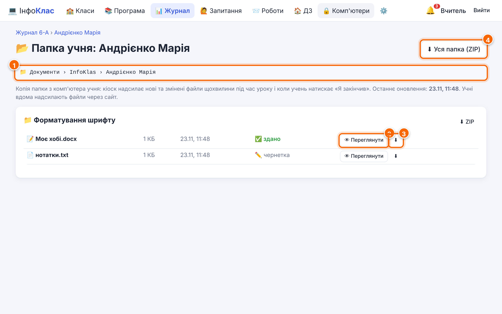

1. Шлях до папки на комп'ютері учня.
2. **👁 Переглянути** — документ відкривається прямо в браузері, нічого не завантажуючи: Word (`.docx`), PDF, зображення, текст і код (`.txt`, `.py`, `.html` …).
3. **⬇** — завантажити й відкрити у своїй програмі (Excel, PowerPoint, Scratch тощо).
4. **⬇ Уся папка (ZIP)** — усі уроки учня; **⬇ ZIP** біля уроку — лише цей урок.

Позначки: **✅ здано** — файл надіслано з «Я закінчив»; **✏️ чернетка** — учень ще працює (автосинхронізація). Сірим показано попередні версії того самого файлу.

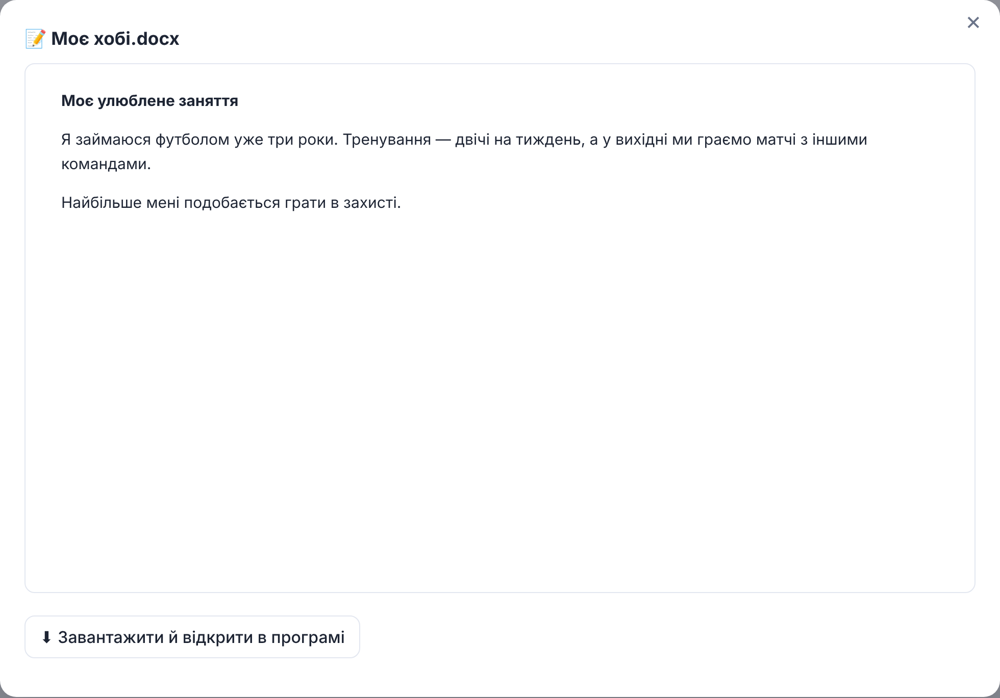

> Перегляд у браузері показує текст і основне оформлення (заголовки, жирний, списки, таблиці). Щоб перевірити точне оформлення (шрифт, колір, розміри), натисніть **⬇ Завантажити й відкрити в програмі**.

## 15. Роботи, домашні завдання, профіль учня

**📨 Роботи** — усі здані роботи (практичні з файлами та ДЗ); нові позначені синьою смужкою. Клік — переглянути й поставити оцінку.

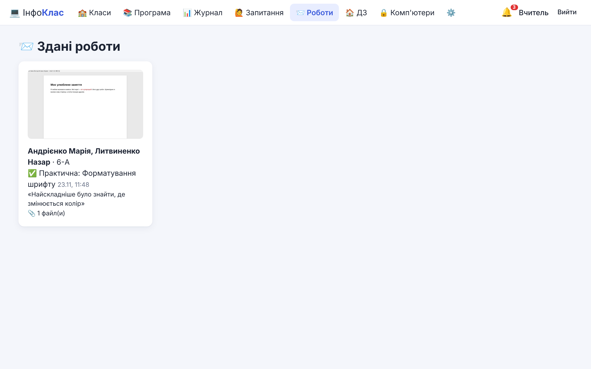

**🏠 ДЗ → + Задати:** клас, урок (текст підставиться з уроку), завдання, термін.

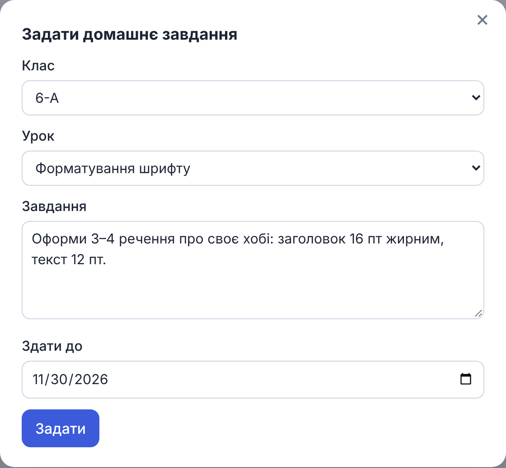

**Профіль учня** (клік на ім'я): уроки та їхні стани, оцінки, відвідування, **де сидів і з ким**, входи в систему (з класу / з дому, з якого ПК).

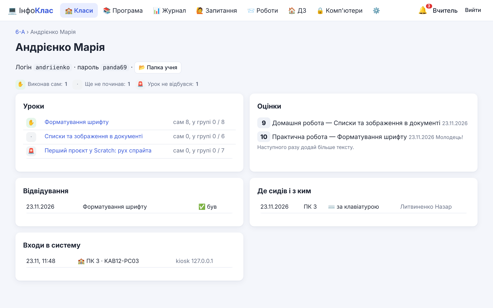

## 16. Поради з методики

- **Мета і «навіщо»** на початку кожного уроку — учні бачать, що вони вивчають і для чого.
- **Короткі кроки.** Одна дія — один крок; додайте зображення до складних кроків.
- **Банк пояснень.** Відповідайте на запитання так, щоб пояснення знадобилося й іншим — воно збережеться до кроку.
- **Ротація ролей.** Натискайте «🔄 Поміняти ролі» посередині уроку; стовпець ⌨️ у журналі покаже, хто ще мало працював руками.
- **«Виконав» ≠ «вміє».** Підтверджуйте ⭐ після короткої перевірки — так журнал показує реальні вміння.
- **Самооцінка.** Порівнюйте 🟢🟡🔴 учня з результатом — це привід для розмови.
- **Зриви уроків.** Позначайте 🚨 — учні побачать урок у «Треба наздогнати» і зможуть виконати його вдома.
- **Тренування.** Додавайте 3–5 питань до кожного уроку — система сама нагадуватиме повторити.
